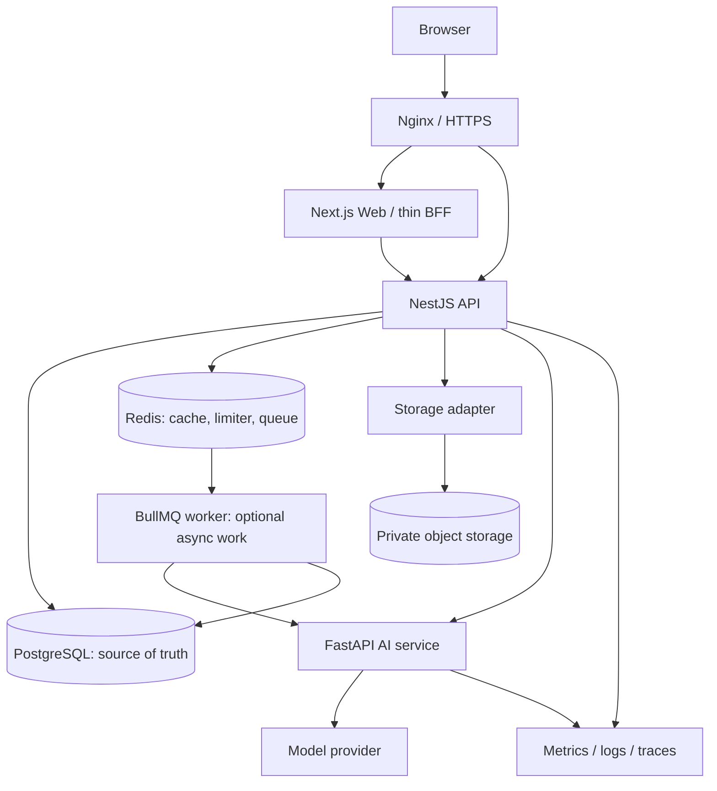
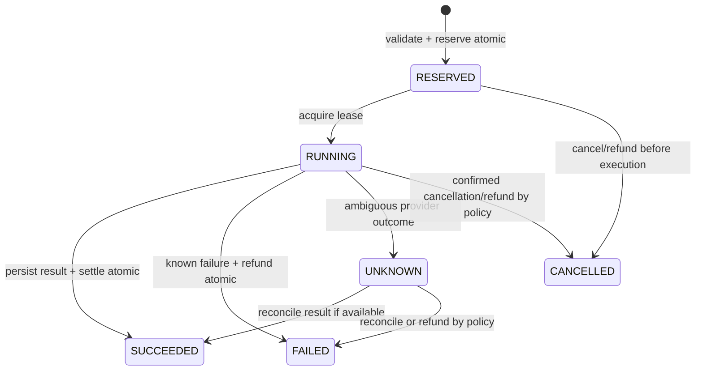
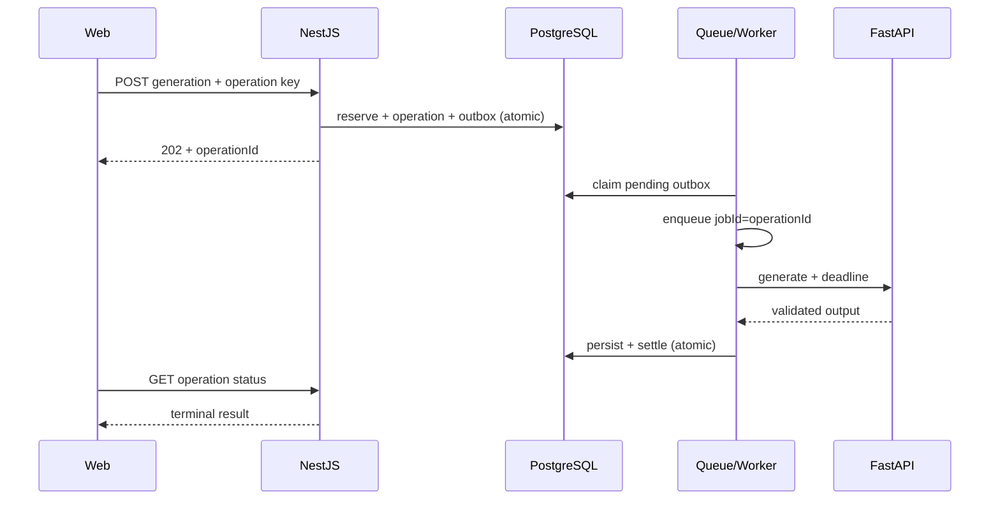
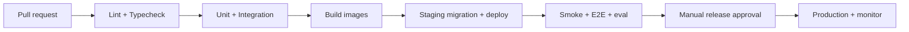
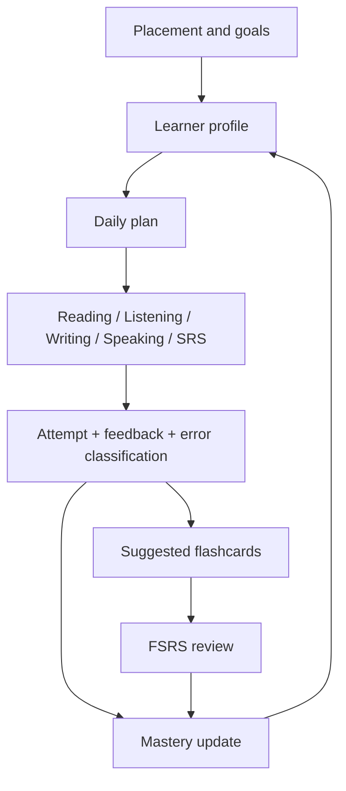

# LinguaAI Smart Learning — Engineering Roadmap & Implementation Backlog

> Tài liệu triển khai kỹ thuật cho một developer làm sản phẩm độc lập. Mục tiêu: sửa lỗi hiện hữu, đưa sản phẩm lên staging ổn định, kiểm chứng khả năng vận hành, rồi phát triển Adaptive Learning Engine.

- **Nguồn:** `linguaai-smart-learning-main.zip`, archive commit `a35d68c916615aa34f1758281a59e6c84ea0d52f`.
- **Phạm vi:** Next.js, NestJS, FastAPI, PostgreSQL, Prisma, Redis, AI provider, frontend, testing, DevOps và product engineering.
- **Phương pháp:** đối chiếu static source của ZIP với review trước đó. Chưa chạy toàn bộ build/test/benchmark ở lần tạo tài liệu này. Không coi một tính năng đã có code là đã được chứng minh đúng.
- **Ký hiệu:** `[ ]` là công việc chưa xác nhận hoàn thành; **Xác nhận** là hành vi nhìn thấy trong source; **Rủi ro** là giả thuyết cần test; **Đề xuất** là thiết kế mới, không phải file hay chức năng đã có.
- **P0:** chặn public beta nếu chưa xử lý; **P1:** độ tin cậy/vận hành; **P2:** tối ưu theo dữ liệu và phát triển sản phẩm. Ưu tiên P0 trước, nhưng viết regression test cùng lúc với sửa lỗi.

## 0. Mục lục và đường đi

1. [Hiện trạng và lỗi xác nhận](#1-hiện-trạng-và-lỗi-xác-nhận)
2. [Kiến trúc mục tiêu](#2-kiến-trúc-mục-tiêu)
3. [Sprint 0 — Baseline](#3-sprint-0--baseline)
4. [Sprint 1 — Chat và token](#4-sprint-1--chat-và-token-p0)
5. [Sprint 2 — Security](#5-sprint-2--security-p0)
6. [Sprint 3 — Reliability và refactor](#6-sprint-3--reliability-và-refactor-p1)
7. [Sprint 4 — Database](#7-sprint-4--database-p1)
8. [Sprint 5 — AI Engineering](#8-sprint-5--ai-engineering-p1p2)
9. [Sprint 6 — Frontend](#9-sprint-6--frontend-p1)
10. [Sprint 7 — Testing](#10-sprint-7--testing-p0p1)
11. [Sprint 8 — DevOps và performance](#11-sprint-8--devops-và-performance-p1p2)
12. [Sprint 9 — Adaptive Learning](#12-sprint-9--adaptive-learning-p2)
13. [Release, portfolio và công việc hằng ngày](#13-release-portfolio-và-công-việc-hằng-ngày)

## 1. Hiện trạng và lỗi xác nhận

### 1.1. Source map

```text
apps/
  web/                       Next.js / React / TypeScript
    src/app/(dashboard)/     màn hình học tập
    src/app/api/             Next.js server routes
    src/stores/              Zustand (auth, token, language...)
    src/components/cms/      CMS
    e2e/                     Playwright
  api/                       NestJS
    src/auth/                identity, session, MFA
    src/tokens/              balance, ledger, quota
    src/chat/                hội thoại AI
    src/srs/                 FSRS, SM-2, review
    src/learning/            completion, communication scenarios
    src/writing/             feedback và lịch sử
    src/speaking/            HTTP + WebSocket
    src/reading/             reading
    src/files/               uploads
    src/common/services/     Groq, AI client, Redis, rate limiter...
    src/health/              probes
    prisma/schema.prisma     database model
    test/                    NestJS E2E
  ai-service/                FastAPI / Python
    app/routers/             AI feature endpoints
    app/prompts/             prompt templates
    app/models/schemas.py    Pydantic models
    app/services/            LLM client, cache
    tests/                   Pytest
packages/                    shared workspace
 docker/                     Dockerfiles, docker-compose.yml
```

Tận dụng những gì đã có: transaction Serializable và server-side pricing trong `TokensService`, idempotency key unique ở ledger, SRS review events, các guard và test hiện hữu, Redis, prompt schemas. Không viết lại chỉ vì muốn thêm design pattern.

### 1.2. Danh sách lỗi đã đối chiếu lại

| ID | Ưu tiên | Vị trí hiện hữu | Bằng chứng từ source | Hướng xử lý |
|---|---|---|---|---|
| BUG-01 | P0 | `apps/api/src/tokens/tokens.controller.ts` | `purchaseTokens()` gọi `addTokens()` theo `dto.amount` mà không có xác minh thanh toán | Đóng route purchase; chỉ grant qua nghiệp vụ đã xác minh |
| BUG-02 | P0 | `apps/api/src/chat/chat.controller.ts` | `stream()` gọi `groqService.chatStream()` nhưng không reserve/debit token | Đưa billing vào orchestration phía server |
| BUG-03 | P0 | `apps/web/src/app/(dashboard)/chat/page.tsx`, `apps/api/src/chat/chat.service.ts` | Sau SSE, `persist()` gọi `/chat/send`, service lại gọi LLM; frontend tiếp tục gọi `consumeAndRun()` | Một turn, một workflow, một kết quả được commit; loại bỏ debit phía UI |
| BUG-04 | P0 | `apps/web/src/app/(dashboard)/chat/page.tsx` | Parser `chunk.split("\n")`, không giữ buffer qua chunk; không yêu cầu terminal DONE trước khi persist | Parser chuẩn SSE, chỉ coi hoàn tất sau terminal event |
| BUG-05 | P0 | `apps/api/src/chat/chat.controller.ts`, `chat.service.ts`, `tokens.service.ts` | Idempotency nằm ở debit, sau đó service vẫn thực thi AI; stream không đi qua cùng workflow | Request record + unique scope + lifecycle |
| BUG-06 | P1 | `apps/api/src/tokens/tokens.service.ts` | Top-up dựa vào Redis và tính amount ngoài transaction; khi số dư đã đủ không có DB marker ngày; ngày UTC và local midnight dùng lẫn | DB day marker, chính sách ngày thống nhất, tính grant atomically |
| BUG-07 | P1 | `apps/api/src/health/health.controller.ts` | `readiness()` trả body degraded nhưng không đặt HTTP 503 | Return 503 khi dependency bắt buộc down, 200 khi ready |
| BUG-08 | P1 | `docker/docker-compose.yml`; `apps/web/src/app/api/` | Web chỉ khai báo `NEXT_PUBLIC_API_URL` nhưng các route AI còn đọc `GROQ_API_KEY`; route server có fallback localhost | Tách public/internal URL, di chuyển AI route, validate env |
| BUG-09 | P1 | `apps/api/src/files/files.service.ts` | `writeFileSync`, local uploads; compose chưa có uploads volume | Storage interface, async IO, persistent storage, sau đó object storage |
| BUG-10 | P1 | `apps/api/src/writing/writing.service.ts` | Luồng feedback normalize score; history/detail dùng `rawScore * 10` | Scale có khai báo rõ, normalize một lần, migration tương thích |
| BUG-11 | P1 | `apps/api/src/learning/learning.service.ts` | `saveCompletion()` upsert chỉ update duration | Attempts bất biến + completion summary; quy định điểm và thời gian |

**Rủi ro cần tái hiện:** debit lặp thực tế, mất cập nhật khi race, top-up vượt chính sách, request disconnect nhưng upstream chưa dừng, request khác user đọc được dữ liệu, cache stale, compose startup, score bất nhất. Mức độ ảnh hưởng thực tế phải xác nhận bằng test; không suy từ code rằng đã có người dùng bị ảnh hưởng.

### 1.3. Quyết định sản phẩm cần chốt

- [ ] Token học tập là credit nội bộ, tách biệt token đầu vào/đầu ra do LLM provider tính phí.
- [ ] Chọn chính sách free credit: top-up tối thiểu 30/ngày UTC (giữ gần code hiện tại), hoặc grant 30/ngày; **không** trộn hai cách.
- [ ] Chọn chính sách khi AI timeout, ngắt kết nối và output không đạt yêu cầu.
- [ ] Với chat, một conversation chỉ cho phép một turn đang chạy (MVP); không cấm hai conversation độc lập.
- [ ] Chọn ngôn ngữ và nhóm người học đầu tiên cho beta, ví dụ English A2–B1.
- [ ] Chưa bật thanh toán thật khi chưa đủ điều kiện pháp lý, xác minh và quyền sử dụng tài khoản thanh toán.

## 2. Kiến trúc mục tiêu

Giữ NestJS modular monolith, Next.js UI và FastAPI. Không cần Kafka, Kubernetes, sharding hay thêm microservices chỉ để học. Queue/object storage/tracing bổ sung khi đáp ứng nhu cầu cụ thể.



| Layer | Sở hữu | Không nên sở hữu |
|---|---|---|
| Next.js | UI state, accessibility, rendering, session transport, thin BFF nếu cần | Quyết định giá token, gọi LLM bypass backend |
| NestJS | Auth, authorization, domain logic, billing, progress, orchestration, persisted request state | Prompt chuyên biệt rải rác khắp controller |
| FastAPI | Prompt, model client, schema validation, streaming provider, model routing, eval | Quyết định balance hoặc quyền sở hữu dữ liệu user |
| PostgreSQL | Ledger, request states, messages, attempts, learner state, durable jobs/outbox khi cần | Cache TTL |
| Redis | Cache, distributed rate limiter, queue transport | Số dư chính thức hoặc bằng chứng duy nhất đã grant credit |
| Object storage | Audio/image/blob private | Metadata quyền sở hữu (nằm DB) |

### 2.1. Quy tắc thiết kế

- Transaction DB ngắn; không giữ lock trong lúc đợi LLM/network.
- PostgreSQL là nguồn chân lý của token và các hiệu ứng nghiệp vụ.
- Cache có thể mất; ledger không được mất hoặc sai.
- Một operation ID cho một ý định người dùng; retry phải giữ ID.
- Một request có thể tạo nhiều provider attempts khi lỗi không xác định; không hứa exactly-once network call. Mục tiêu là exactly-once **business effects** trong phạm vi DB và giảm duplicate provider calls.
- Không ghi prompt, audio, transcript, JWT hoặc secret vào log mặc định.
- Mỗi PR phải có test tương ứng, migration an toàn và hướng rollback nếu ảnh hưởng DB.

## 3. Sprint 0 — Baseline

**Mục tiêu:** thiết lập một môi trường tái hiện lỗi, có lệnh build/test rõ ràng, không dùng credential production.

### BASE-01 — Chuẩn bị môi trường [P0]

- [ ] Đọc `SETUP.md`, `.env.example`, `apps/ai-service/.env.example`, Dockerfiles.
- [ ] Dùng branch `chore/baseline` từ phiên bản hiện tại; tạo DB/Redis local riêng.
- [ ] Kiểm tra Node, Python, Docker; chọn Node phù hợp Prisma 7 và phiên bản dependency hiện tại.
- [ ] Cài pnpm đúng package manager trong root (`pnpm@9.15.0`), dùng virtualenv cho Python.
- [ ] Điền secret local ngẫu nhiên, không commit `.env`; kiểm tra Git history xem có secret từng bị commit không.

```bash
# Chạy từ root repo, sau khi cấu hình môi trường local theo SETUP.md.
node -v
pnpm -v
python3 --version
docker compose version
pnpm install --frozen-lockfile
pnpm --filter api db:generate
pnpm --filter api type-check
pnpm --filter web type-check
pnpm --filter api lint
pnpm --filter web lint
pnpm --filter api test --runInBand
pnpm --filter web test:run
pnpm build

# Python AI service
cd apps/ai-service
python3 -m venv .venv
source .venv/bin/activate
python -m pip install -r requirements.txt
# Cài pytest và dependency test theo config nếu chưa nằm trong requirements.
python -m pytest -q
```

Chạy E2E sau khi dựng database test, migrate/seed theo hướng dẫn repo, cấu hình URL test. Không chạy suite có reset/truncate trên database production.

```bash
pnpm --filter api test:e2e
pnpm --filter web exec playwright test
```

### BASE-02 — Tạo baseline report [P0]

- [ ] Ghi commit SHA, version runtime, command, exit code và lỗi đầu tiên vào `docs/baseline.md` (file mới đề xuất).
- [ ] Liệt kê endpoint bằng Swagger và controller, xác định endpoint có auth/role/quota.
- [ ] Chụp kết quả unit, E2E, lint, typecheck, build; không che test fail bằng skip.
- [ ] Tạo fixture user A/B, admin test, dữ liệu chat và flashcards; chỉ dùng dữ liệu tổng hợp.
- [ ] Mock LLM provider để test không phát sinh phí và có output xác định.

**Nghiệm thu:** developer mới chạy được môi trường local theo một hướng dẫn; mọi lỗi build/test còn lại có issue; không đánh dấu green nếu chưa chạy.

## 4. Sprint 1 — Chat và token (P0)

Đây là sprint phải làm trước. Sửa theo vertical slice: từ HTTP request đến AI provider, ledger, lưu message và UI. Không refactor tất cả module cùng lúc.

### BILL-01 — Đóng token purchase chưa xác minh

**File:** `apps/api/src/tokens/tokens.controller.ts`, `tokens.service.ts`, `dto/tokens.dto.ts`, UI liên quan token.

- [ ] Disable route `POST /tokens/purchase` bằng feature flag mặc định false hoặc bỏ route ở bản beta; response lỗi rõ, không thay đổi balance.
- [ ] Tách internal grant method khỏi public DTO. Client không được định nghĩa grant amount, type, feature hoặc user nhận grant.
- [ ] Giữ `GET /tokens/balance`, `GET /tokens/history` có kiểm tra identity và phân trang history.
- [ ] Không xóa ledger cũ một cách tự động; audit các giao dịch trước migration nếu có dữ liệu thật.

**Nghiệm thu:** request purchase của user bình thường không tăng balance, kể cả request hợp lệ về định dạng; có test xác nhận DB không đổi.

### BILL-02 — Tập trung pricing và billing phía server

`TokensService.COSTS` hiện đã lấy giá từ server. Giữ nguyên điểm tốt này, tránh viết lại bảng giá ở từng controller.

| Feature code hiện hữu | Giá credit hiện tại |
|---|---:|
| ai_chat | 5 |
| writing_feedback | 10 |
| reading_generate | 8 |
| grammar_explain | 5 |
| listening_generate | 8 |
| quiz_generate | 6 |
| translation_ai | 3 |
| speaking_feedback | 10 |
| learning_path | 5 |
| cards_generate | 10 |

- [ ] Tạo pricing policy service hoặc giữ một catalog server có version; trả catalog đọc-only cho UI.
- [ ] Tìm toàn bộ `consumeTokens`, `/tokens/consume`, `consumeAndRun`, `useTokenGate` trong repo; lập bảng feature → server handler → billing owner.
- [ ] Từng AI route phải tự authorize và reserve credit trước khi gọi AI; không coi client-side balance check là kiểm soát bảo mật.
- [ ] Trong giai đoạn chuyển đổi, route consume legacy chỉ giữ khi có caller cũ đã kiểm soát; xóa public route khi chuyển xong để tránh double charge.
- [ ] UI chỉ hiển thị giá/balance, nhận trạng thái operation; invalidate TanStack Query balance sau terminal state.

```bash
rg -n 'consumeTokens|/tokens/consume|consumeAndRun|useTokenGate|GROQ_API_KEY' apps
```

**Nghiệm thu:** feature không thể chạy nếu thiếu quota; server xác định giá; một turn thành công chỉ ghi một debit ròng; số dư UI đồng bộ với server khi refresh.

### BILL-03 — Thiết kế durable AI operation

**File mới đề xuất:** `apps/api/src/ai-operations/` gồm module, service, repository, DTO, policy và tests. Schema migration ở `apps/api/prisma/`.

```text
ai_operations (đề xuất)
  id UUID PK
  user_id UUID FK
  feature VARCHAR
  client_operation_id VARCHAR
  request_hash VARCHAR
  pricing_version VARCHAR
  reserved_credits INT
  charged_credits INT
  status ENUM
  attempt_count INT
  lease_until TIMESTAMPTZ NULL
  conversation_id UUID NULL (nếu chat)
  result_ref UUID NULL
  error_code VARCHAR NULL
  created_at, updated_at, finished_at
  UNIQUE(user_id, feature, client_operation_id)
  INDEX(status, lease_until)
```

Chỉ lưu request hash và dữ liệu tối thiểu để recovery; nếu phải lưu input thì quy định retention và quyền truy cập. Hash canonical JSON của payload đã validate, gồm feature, language, conversation và message. Đừng đưa timestamp ngẫu nhiên vào hash.



**Quy tắc:** terminal states không được quay về RUNNING; cùng key + payload trả lại trạng thái/kết quả đã có; cùng key + payload khác trả HTTP 409; user khác không thể đọc operation. Request đang RUNNING không khởi động LLM lần thứ hai chỉ vì client reconnect.

- [ ] Tạo migration với FK, unique constraint, bounded key, timestamps UTC.
- [ ] Link debit/refund ledger với operation ID và unique `(operation_id, entry_kind)` hoặc deterministic ledger key ngắn hơn 128 ký tự.
- [ ] Thiết kế lease/claim cập nhật có điều kiện; stale worker không được commit kết quả sau khi mất lease (fencing/version).
- [ ] Recovery job kiểm tra trạng thái quá hạn; có giới hạn retry và policy cho UNKNOWN.
- [ ] Không lưu transcript trong Redis key hoặc application logs.

### BILL-04 — Reserve, settle, refund bằng transaction

**Chọn mô hình MVP:** reserve = debit credit ngay khi nhận operation; settle = ghi trạng thái thành công, không trừ thêm; refund = positive ledger entry duy nhất nếu thất bại đủ điều kiện. Cách này đơn giản hơn tách available/held balances. Tên hiển thị trên UI phải rõ credit đang được giữ.

```text
reserve(user, key, validatedPayload):
  transaction:
    tìm operation theo scope; nếu có thì kiểm tra hash và trả existing
    áp dụng grant trong ngày atomically nếu chưa xử lý
    tạo operation RESERVED
    atomic conditional debit: balance >= price
    ghi ledger debit với unique operation key
  commit

run(operation):
  claim lease; commit
  gọi AI bên ngoài transaction
  validate output
  transaction:
    kiểm tra state + lease version
    ghi kết quả nghiệp vụ
    cập nhật SUCCEEDED, charged_credits = reserved_credits
  commit

fail(operation):
  transaction:
    chỉ chuyển state nếu chưa terminal và có quyền xử lý
    cộng lại đúng credit đã reserve (nếu policy cho refund)
    ghi refund ledger với unique key
    cập nhật terminal state
  commit
```

- [ ] Dùng conditional update (`updateMany` theo `balance >= price`, decrement) hoặc row lock; check affected rows.
- [ ] Giữ unique constraint; thêm CHECK balance >= 0 qua SQL migration nếu phù hợp dữ liệu hiện có.
- [ ] Khi Prisma trả P2034 / serialization conflict, retry transaction ngắn có giới hạn và jitter; với P2002 do replay, đọc lại operation sau rollback, không retry toàn bộ AI call.
- [ ] Mọi refund phải xác minh operation, user, amount và trạng thái. Không cho client tùy ý yêu cầu grant.
- [ ] Cache invalidation sau commit, cache chỉ phục vụ đọc; test Redis unavailable. Không authorize debit dựa trên cache.
- [ ] Viết reconciliation: số dư = opening balance + tổng ledger entries sau migration; không tự sửa sai lệch âm thầm.

**Ví dụ nghiệm thu:** bắt đầu 10 credit, 3 request độc lập giá 5 chạy đồng thời, tối đa 2 thành công; khi 1 operation fail đủ điều kiện thì refund đúng 5 và không hoàn lần hai. Test không phụ thuộc vào auto-topup: cố định policy và fixture ngày.

### BILL-05 — Daily top-up và check-in chính xác

**Hiện trạng:** `checkAndApplyDailyTopup()` và `dailyCheckIn()` trong `tokens.service.ts` dùng UTC date, nhưng thống kê today dùng local `setHours`. Top-up tính amount trước transaction; khi balance >=30 chỉ ghi marker Redis.

- [ ] Chọn UTC day thống nhất hoặc timezone user theo policy đã công bố; dùng cùng boundary cho grant và daily usage.
- [ ] Thêm `daily_credit_grants` (đề xuất) unique `(user_id, grant_type, day)` kể cả amount = 0, không phụ thuộc Redis để biết đã xử lý ngày.
- [ ] Tính amount từ balance hiện tại trong cùng transaction có lock/conditional update.
- [ ] Check-in streak dùng các grant ngày thực tế; định nghĩa missed day/reset, duplicate response.
- [ ] Xử lý P2002/P2034 với read/retry bounded, không lộ 500 cho thao tác replay bình thường.
- [ ] Test cache flush, hai instance, UTC midnight, số dư đã >=30 rồi tiêu credit trong cùng ngày, top-up chồng với grant/debit.

### CHAT-01 — Thiết kế API contract mới

**Giữ route cũ trong giai đoạn migrate nếu cần, nhưng cả streaming và non-streaming phải gọi chung orchestration.**

```http
POST /api/v1/chat/stream
Authorization: Bearer <access-token>
Idempotency-Key: <uuid-created-once-per-turn>
Content-Type: application/json

{"conversationId":null,"language":"english","message":"How do I use the past simple?"}
```

- [ ] Validate UUID/length, language allowlist, message nonempty, max length; kiểm tra ownership trước reserve.
- [ ] Thay client-supplied history bằng history đọc từ DB theo đúng conversation và context window; tránh client tự tạo role assistant làm nguồn chân lý.
- [ ] Nếu tạo conversation mới, gắn ID với operation để retry không tạo conversation trùng.
- [ ] Đặt giới hạn một in-flight turn/conversation; unique/lock trong DB, không chỉ state frontend.
- [ ] Đề xuất endpoint `GET /api/v1/ai-operations/:id` và lookup theo idempotency key có scope để phục hồi sau mất kết nối.

SSE contract đề xuất:

```text
event: accepted
data: {"operationId":"op-uuid","conversationId":"conv-uuid"}

event: delta
data: {"seq":1,"text":"The past simple"}

event: completed
data: {"operationId":"op-uuid","messageId":"msg-uuid","balance":25}

```

Lỗi trước headers dùng HTTP 400/401/403/409/429/503 tùy contract; sau headers dùng `event: failed` với error code an toàn. `completed` chỉ gửi sau transaction commit thành công; không coi EOF là success. 202/status endpoint hoặc replay kết quả khi cùng key vẫn RUNNING.

### CHAT-02 — Một turn, một workflow, một kết quả lưu

**File hiện tại:** `chat.controller.ts`, `chat.service.ts`, `dto/chat.dto.ts`, `common/services/groq.service.ts`, `common/services/ai-client.service.ts`, `apps/ai-service/app/routers/chat.py`.

- [ ] Controller chỉ validate/forward transport; orchestration service sở hữu lifecycle.
- [ ] Reserve trước khi flush SSE headers. Lỗi authorization/quota không được mở provider stream.
- [ ] Tạo history từ DB, build server system prompt; stream qua adapter duy nhất.
- [ ] Tích lũy output với giới hạn kích thước; delta hiển thị và final content lấy từ cùng provider response.
- [ ] Trong finalize transaction, lưu user/assistant messages có operation ID unique theo role và state SUCCEEDED. Không lưu message assistant do client gửi để giả làm AI.
- [ ] Dùng `res.close`/abort signal và kiểm tra lifecycle phù hợp runtime; truyền cancellation xuống provider khi hỗ trợ. Không chỉ dừng ghi socket.
- [ ] Xử lý backpressure (`res.write()` false → chờ drain hoặc abort), heartbeat, deadline, giới hạn output; không giữ promise/stream vô hạn.
- [ ] Khi provider error sau delta, hiển thị incomplete/failed, không đánh dấu học xong. Khi disconnect sau commit, status endpoint trả success đã lưu.
- [ ] Không trả raw `String(err)` từ provider về client; map error code, log request ID và metadata đã lọc.

### CHAT-03 — Sửa frontend stream parser và state

**File:** `apps/web/src/app/(dashboard)/chat/page.tsx`, `src/stores/token-store.ts`, `src/lib/api-client.ts`.

- [ ] Xóa `persist()` gọi `/chat/send` sau SSE và `consumeAndRun()` dùng để trừ credit ở chat.
- [ ] Sinh key khi click gửi, giữ key khi refresh auth hoặc retry cùng turn.
- [ ] Tách hook `useChatStream` (đề xuất) với states idle/submitting/streaming/completed/failed/cancelled/reconnecting.
- [ ] Dùng `TextDecoder` streaming, buffer phần chưa đủ dòng/event, parse CRLF và event phân tách bởi blank line; flush decoder ở EOF.
- [ ] Không skip malformed terminal event và coi thành công; nếu stream kết thúc không terminal, query operation status.
- [ ] Giữ sequence/abort guard hiện hữu, nhưng chỉ clear controller ref nếu chính request đó còn sở hữu ref; tránh request cũ xóa controller của request mới.
- [ ] Hiển thị partial result rõ, không tự tạo answer giả vào history; invalidate messages/balance theo operation status.
- [ ] Unit test parser với Unicode đa byte, event bị chia nhỏ, nhiều event một chunk, lỗi, EOF thiếu terminal, cancel và 401 refresh.

### CHAT-04 — Test matrix bắt buộc

| Test | Thiết lập | Kết quả cần đạt |
|---|---|---|
| T01 | Balance đủ, fake LLM stream thành công | Một provider attempt, một debit, hai message đúng, completed sau commit |
| T02 | Balance thiếu | Không gọi LLM, không ghi debit/message |
| T03 | Language không hợp lệ | 400 trước mọi side effect |
| T04 | Conversation user khác | 404/403, không debit, không lộ nội dung |
| T05 | Cùng key cùng payload tuần tự | Trả lại result, không debit thêm |
| T06 | Cùng key đồng thời | Một operation được claim, một debit |
| T07 | Cùng key khác payload | 409, không thay đổi operation cũ |
| T08 | Key giống nhưng user khác | Hai scope riêng, không lộ balance/result |
| T09 | Provider timeout trước delta | Terminal failure hoặc UNKNOWN theo policy; refund tối đa một lần |
| T10 | Provider error sau delta | Không completed, UI hiển thị incomplete |
| T11 | Disconnect trước commit | Recovery theo policy, không mất ledger |
| T12 | Disconnect sau commit trước completed event | Status trả kết quả đã lưu, replay không gọi AI lại |
| T13 | Crash sau reserve trước provider | Lease/recovery giải phóng operation đúng policy |
| T14 | Crash sau provider trước commit | UNKNOWN, reconcile; không hứa provider exactly-once |
| T15 | Hai turn khác nhau cùng conversation | Tuân thủ chính sách single in-flight |
| T16 | Redis down | Billing DB vẫn chính xác; rate limiter fail theo policy |
| T17 | P2034 khi reserve/finalize | Bounded transaction retry, không retry LLM bừa |
| T18 | Retry refund | Không cộng hai lần |
| T19 | Chunk SSE bị chia bất kỳ | Text Unicode giữ nguyên, không mất event |
| T20 | EOF không completed | Không đánh dấu success chỉ vì EOF |

**Sprint gate:** BUG-01–05 đóng khi test pass trên PostgreSQL thật, mock provider; BUG-06 có regression riêng. Chưa mở public beta nếu gate chưa đạt.

## 5. Sprint 2 — Security (P0)

Mục tiêu: bảo vệ user, dữ liệu học tập và ngân sách AI. Security là một phần của nghiệp vụ, không phải thêm một middleware là xong.

| ID | Công việc | File/module hiện hữu cần kiểm tra | Nghiệm thu |
|---|---|---|---|
| SEC-01 | Lập authorization matrix user/admin/public/service | `apps/api/src/auth/`, `common/guards/`, `admin/`, controllers | Mỗi route có policy rõ ràng; test unauthenticated và wrong role |
| SEC-02 | Ownership tại service/repository cho mọi resource | chat, decks, cards, srs, writing, speaking, reading, quiz, files | User B không đọc/sửa/xóa tài nguyên A, kể cả ID hợp lệ |
| SEC-03 | Refresh rotation, logout, device revocation | `auth/services/`, `web/src/lib/api-client.ts` | Token cũ không dùng lại trái policy; concurrent refresh có test |
| SEC-04 | MFA và OAuth | auth services, OAuth callbacks | Kiểm tra state/nonce theo giao thức, recovery, enrollment, session binding |
| SEC-05 | Cookie/CORS/CSRF | `main.ts`, web auth routes, CSRF service | Cookie HttpOnly/Secure/SameSite phù hợp; origin allowlist; test CSRF với cookie-auth |
| SEC-06 | Distributed rate limiting | `common/services/rate-limiter.service.ts`, Redis | Giới hạn theo user/IP/feature, dùng chung qua nhiều instance; response 429 và retry-after |
| SEC-07 | Input limits | DTOs, multipart parser, WebSocket gateway | Reject body/upload/audio/message quá mức trước xử lý đắt tiền |
| SEC-08 | File privacy và content validation | files, speaking, CMS uploads | MIME/signature validation; tên object server tạo; signed URL ngắn hạn nếu private |
| SEC-09 | AI abuse guard | AI orchestration, FastAPI schemas/prompts | Giới hạn context/output/concurrency/budget; không cấp quyền hệ thống từ output AI |
| SEC-10 | Secrets management | `.env.example`, Docker, CI, web routes | Không có key trong client bundle/log/repo; rotate nếu từng lộ |
| SEC-11 | Privacy và deletion | users, chat, submissions, files, caches | Xóa/export dữ liệu đúng quyền, retention có tài liệu; không log transcript/audio mặc định |
| SEC-12 | Dependency audit | pnpm lockfile, Python requirements, images | Triage vulnerability theo ảnh hưởng; fix hoặc ghi risk acceptance |

### 5.1. Authorization matrix mẫu (đề xuất)

| Resource | Guest | Owner | Non-owner | Admin |
|---|---|---|---|---|
| Published lesson | Theo policy | Read | Read | Quản lý theo role |
| Chat | 401 | CRUD giới hạn | 404/403 | Không mặc định đọc nội dung riêng tư |
| Deck riêng | 401 | CRUD | 404/403 | Chỉ quyền được thiết kế rõ |
| Token balance/ledger | 401 | Read | 404/403 | Grant chỉ qua audited service |
| Audio cá nhân | 401 | Read/delete | 404/403 | Truy cập đặc biệt phải audit |
| CMS draft | 401 | Không nếu user thường | Không | Role CMS đúng |
| AI internal route | Không | Qua NestJS | Không | Service credential, không dùng admin JWT thay service auth |

### 5.2. Rate limiting theo từng tầng

- [ ] Reverse proxy: giới hạn request/body và burst; lấy client IP từ trusted proxies, không tin header tùy ý.
- [ ] NestJS: key theo user + feature; budget và concurrent operations. Endpoint auth có limiter riêng theo identity/IP.
- [ ] FastAPI: chỉ service được phép truy cập, giới hạn upstream concurrency và provider budget toàn hệ thống.
- [ ] Redis lỗi: route AI tốn phí fail closed hoặc dùng fallback bảo thủ được thiết kế rõ; read-only cache có thể degrade. Không vô tình unlimited.
- [ ] Test 429 qua hai instance, reset TTL, concurrency limit, limiter cleanup khi cancel.

Giá trị khởi điểm để **đo trong staging**, không phải capacity đã xác minh: chat 10 requests/phút/user, 1 turn/conversation; content generation 3/phút/user, tối đa 2 job đồng thời; tổng upstream concurrency ban đầu nhỏ (ví dụ 4–8), sau đó chỉnh theo rate limit provider và kết quả đo. Không hardcode chung cho mọi feature.

### 5.3. AI safety và privacy

- [ ] Prompt template và tool instructions được kiểm soát server; user text chỉ là input dữ liệu. Strip HTML không phải biện pháp bảo đảm chống prompt injection.
- [ ] Schema validation cho output, không chạy code hoặc HTML từ LLM; render text/Markdown an toàn, kiểm tra link.
- [ ] Nội dung học tập phù hợp lứa tuổi, cho phép report feedback sai/không phù hợp; không dùng AI làm đánh giá chứng chỉ chính thức.
- [ ] Chính sách audio/transcript: mục đích, retention, xóa dữ liệu, provider xử lý ra sao; thu thập ít nhất có thể.
- [ ] Nếu mở beta cho người chưa thành niên, cần xem xét điều kiện đồng ý và nghĩa vụ bảo vệ trẻ em trước khi thu thập dữ liệu, đặc biệt audio.

**Sprint gate:** authorization matrix đã có test, không còn P0 mở, không exposed secret, quota enforce ở server. Các vấn đề chưa test phải ghi rõ là chưa xác nhận.

## 6. Sprint 3 — Reliability và refactor (P1)

### REL-01 — Chuẩn hóa AI client và lỗi

- [ ] Tạo contract giữa NestJS và FastAPI cho request ID, feature, schema version, deadline, model config, result/error.
- [ ] Giữ `apps/api/src/common/services/ai-client.service.ts` làm adapter gọi FastAPI; `groq.service.ts` chỉ tồn tại trong giai đoạn migration nếu còn caller.
- [ ] FastAPI `app/services/llm_client.py` là nơi quản lý model provider; reuse HTTP client và connection pool.
- [ ] Mã lỗi đề xuất: `VALIDATION_ERROR`, `INSUFFICIENT_CREDITS`, `OPERATION_CONFLICT`, `RATE_LIMITED`, `PROVIDER_UNAVAILABLE`, `PROVIDER_TIMEOUT`, `INVALID_AI_OUTPUT`, `OPERATION_UNKNOWN`, `INTERNAL_ERROR`.
- [ ] Timeout riêng connect/read/overall; retry chỉ lỗi transient, bounded attempts, jitter; không retry invalid input hay lỗi auth.
- [ ] Nếu đã stream một phần thì không tự restart stream từ đầu như một lần thành công duy nhất; xử lý failed/UNKNOWN và cho retry có chủ đích.
- [ ] Circuit breaker theo provider/model khi lỗi kéo dài; đo open/half-open/closed; fallback chỉ khi tương thích schema và budget.

```json
{
  "error": {
    "code": "PROVIDER_TIMEOUT",
    "message": "AI service temporarily unavailable",
    "retryable": true,
    "requestId": "request-uuid",
    "operationId": "operation-uuid"
  }
}
```

### REL-02 — Migration AI routes từng feature

Danh sách route Next.js đã thấy trong ZIP, không giả định tất cả có cùng cách auth/billing. Kiểm tra từng route trước chuyển.

| Thứ tự | Route hiện tại / module | Công việc |
|---:|---|---|
| 1 | NestJS chat | Hoàn thành Sprint 1, sau đó chuyển provider stream qua FastAPI |
| 2 | `app/api/translation/generate/route.ts` | Chuyển generate vào backend operation + FastAPI, giữ response contract UI |
| 3 | `app/api/listening/generate/route.ts` | Quota, validated content, queue nếu job dài |
| 4 | `app/api/speaking/route.ts`, `speaking/topic/route.ts` | Tách topic generation, recording upload, feedback; kiểm tra NestJS speaking gateway |
| 5 | `app/api/cms/lessons/generate-from-transcript/route.ts` | Admin policy, job orchestration, draft review |
| 6 | `app/api/cms/upload/route.ts`, `upload-audio/route.ts`, `listening/upload-user/route.ts` | Chuyển storage qua service có ownership; không mặc định cần AI |
| 7 | NestJS grammar/writing/reading/cards/quiz | Audit hiện trạng; reuse adapter và billing thay vì thay đổi nghiệp vụ không cần thiết |

Mỗi migration: viết characterization test → tạo backend handler → cập nhật UI → canary/staging → bỏ caller cũ → kiểm tra không còn direct provider call. Không tạo hai luồng billing trong giai đoạn chuyển.

### REL-03 — Background job processing (BullMQ đề xuất)

Chỉ dùng queue cho tác vụ có thể hoàn thành bất đồng bộ: generate lesson, quiz/deck nhiều item, xử lý feedback audio dài, notification. Chat SSE realtime không bắt buộc qua queue.



- [ ] Tạo queue names và payload version; job chỉ chứa IDs, không chứa secret/audio raw.
- [ ] `jobId = operationId` để giảm enqueue trùng; DB state vẫn bảo vệ business effects khi queue retry hoặc job bị xóa.
- [ ] Outbox table nếu cần bảo đảm DB reserve và enqueue không rơi vào khe lỗi giữa hai hệ thống; publisher claim row và đánh dấu published sau enqueue; reconcile pending.
- [ ] Worker concurrency giới hạn; timeout/cancellation, max attempts, exponential backoff.
- [ ] Failed jobs có retention/alert; manual retry chỉ khi policy cho phép, ghi audit.
- [ ] Graceful shutdown: ngừng nhận job mới, đợi giới hạn thời gian, release lease hoặc recover sau restart.
- [ ] Test Redis restart, worker chết, enqueue trùng, provider 429, poison job, outbox backlog.

### REL-04 — Lưu trữ file

**Hiện trạng xác nhận:** `files.service.ts` ghi local bằng `writeFileSync`, trả URL uploads. Đây chưa phải shared storage cho nhiều instance.

- [ ] Tạo `StoragePort` interface: put/get/delete/head/signedReadUrl; implementation local dev và S3-compatible staging.
- [ ] Bước ngắn hạn: async filesystem API và persistent volume riêng; không coi đây là multi-instance solution.
- [ ] Bước tiếp theo: MinIO local/staging hoặc object storage managed; private bucket theo loại dữ liệu; credentials giới hạn quyền.
- [ ] DB lưu object key, owner, size, MIME, status, checksum; URL ngắn hạn tạo sau authorization.
- [ ] Upload giới hạn ngay tại parser/proxy; stream khi thích hợp, tránh buffer file lớn trong RAM.
- [ ] DB và object store không cùng transaction: dùng pending/ready/deleting state, cleanup orphan và retry delete.
- [ ] Test upload ở instance A, read/delete ở B, wrong user, oversize, malformed, storage timeout và failed finalize.

**Sprint gate:** feature được chuyển không còn gọi provider từ frontend route; async job có recovery và idempotency; file không mất khi restart theo môi trường đã chọn.

## 7. Sprint 4 — Database (P1)

**File trung tâm:** `apps/api/prisma/schema.prisma`. Các model hiện có gồm `user_card_progress`, `srs_review_events`, `learning_completions`, `chat_messages`, `chat_conversations`, `writing_submissions`, `speaking_submissions`, `token_transactions`, `user_token_balance`.

### DB-01 — Kiểm tra schema và invariants

- [ ] Review PK/FK, cascade behavior, nullable fields, unique constraints, enum và lengths.
- [ ] Tạo inventory: table, cardinality, write/read path, index, retention, PII, ownership.
- [ ] Kiểm tra token balance >=0; ledger immutable theo application policy; correction dùng compensating entry, không sửa lịch sử tùy tiện.
- [ ] Kiểm tra xóa account có phù hợp retention và object cleanup; không tự động giữ PII vô thời hạn.
- [ ] Kiểm tra timestamp UTC và timezone conversion tại UI; phân biệt instant/timestamp/date.
- [ ] Audit lịch sử migration, test migrate database trống và database có dữ liệu fixture.

### DB-02 — Learning attempt history

`learning_completions` hiện unique `(user_id, activity_type, activity_id)`, upsert chỉ cập nhật duration. Đề xuất giữ summary và thêm attempt log.

```text
learning_attempts (đề xuất)
  id UUID PK
  user_id UUID FK
  language, activity_type, activity_id, content_version
  client_attempt_id UUID
  raw_score, score_scale, normalized_score, total
  duration_seconds, started_at, completed_at
  feedback_ref nullable
  UNIQUE(user_id, client_attempt_id)
  INDEX(user_id, language, completed_at DESC)

learning_completions (mở rộng đề xuất)
  existing identity / unique key
  first_completed_at, last_completed_at
  attempt_count, best_score, latest_score
  total_duration_seconds
```

- [ ] Định nghĩa học lại tạo attempt mới hay resume cùng attempt; retry cùng attempt key không tăng count.
- [ ] Transaction insert attempt + update summary; atomic increment và best/latest rules rõ ràng.
- [ ] Nếu thêm language vào unique key, xác định activity IDs hiện có có phân biệt language chưa; migration duplicate-safe.
- [ ] Backfill summary từ dữ liệu cũ có đánh dấu `legacy`; không bịa lịch sử attempts chưa từng lưu.
- [ ] Test score thấp/cao qua nhiều attempts, duplicate key, out-of-order completion, concurrent update và analytics.

### DB-03 — Score contract cho Writing/Speaking

**Writing đã xác nhận lỗi:** `writing.service.ts` normalize ở feedback mới nhưng history/detail nhân `rawScore * 10`. Việc suy scale từ độ lớn gây mơ hồ (điểm 1 có thể thuộc thang 10 hoặc thang 1).

- [ ] FastAPI schema trả `score`, `scoreScale` (hoặc `maxScore`), rubric/version; reject ngoài miền.
- [ ] Normalize tại một boundary duy nhất thành 0–100 theo công thức `round(raw / max * 100)`; không dựa vào raw <= 1 để đoán scale.
- [ ] Lưu raw và normalized nếu cần audit; tất cả read endpoints dùng cùng contract.
- [ ] Với dữ liệu legacy thiếu scale: xác định theo prompt/schema version nếu có bằng chứng; nếu không, gắn unknown/review, không sửa âm thầm.
- [ ] Kiểm tra Speaking và level estimation tương tự, nhưng không khẳng định có cùng bug khi chưa test.
- [ ] Test 0, 1/10, 1/1, 8/10, 100/100, null, NaN, âm, overflow và migration legacy.

### DB-04 — Query profiling và index tuning

Chỉ thêm index khi query shape, cardinality, kế hoạch thực thi và workload chứng minh lợi ích. Hiện schema đã có nhiều index đơn.

| Query cần benchmark | Index ứng viên (đề xuất, không apply mù) |
|---|---|
| Flashcard đến hạn của một user | `user_card_progress(user_id, next_review_date)` |
| Chat history phân trang | `chat_messages(conversation_id, created_at, id)` |
| Conversation gần nhất của user | `chat_conversations(user_id, created_at, id)` |
| Writing history | `writing_submissions(user_id, created_at, id)`; thêm language nếu query lọc và schema hỗ trợ |
| Speaking history | `speaking_submissions(user_id, created_at, id)` |
| Token ledger theo user/time | Đã có `(user_id, created_at)`; đo thêm tie-breaker/type nếu query cần |
| Learning progress theo user/language | Đã có `(user_id, language, completed_at)`; đo workload thật |

Lab PostgreSQL (database test, fixture hợp lệ):

```sql
EXPLAIN (ANALYZE, BUFFERS)
SELECT card_id, next_review_date
FROM user_card_progress
WHERE user_id = '<fixture-user-uuid>'::uuid
  AND next_review_date <= CURRENT_TIMESTAMP
ORDER BY next_review_date
LIMIT 50;

-- Thử index ứng viên trong DB test, so sánh cùng dataset và query.
CREATE INDEX lab_progress_user_due_idx
ON user_card_progress (user_id, next_review_date);
ANALYZE user_card_progress;
-- Chạy lại EXPLAIN (ANALYZE, BUFFERS), ghi before/after.
```

- [ ] Tạo seed script có seed random cố định, 10k → 100k → 1M progress/ledger rows theo phân bố nhiều user, không chỉ một user.
- [ ] Đo cold-ish và warm cache, số rows scanned, buffers hit/read, execution time, index size, ảnh hưởng write.
- [ ] Kiểm tra N+1 bằng Prisma query metrics/log ở test; không log dữ liệu query nhạy cảm production.
- [ ] Đẩy aggregate thích hợp xuống SQL: kiểm tra `SrsService.getStats()` và analytics trước/sau.
- [ ] Cursor pagination với `(created_at,id)` ổn định; test timestamp trùng và insert đồng thời.
- [ ] Tính connection budget = pool mỗi process × số processes + worker + migration/admin; giữ dưới DB limit với headroom.

### DB-05 — Backup/restore và migration an toàn

- [ ] Backup tự động, encryption, retention, access; lưu ngoài host chính.
- [ ] Restore sang DB test độc lập, kiểm tra constraints, sample counts và các nghiệp vụ.
- [ ] Thử expand → migrate/backfill → switch readers/writers → contract; migration dài không giữ lock không kiểm soát.
- [ ] Chỉ một migration job mỗi release, không để mọi replica tự chạy migration đồng thời.
- [ ] Rollback app tương thích schema; migration phá dữ liệu cần restore plan riêng.

**Sprint gate:** score nhất quán; attempts không duplicate; report index before/after có số liệu thực; restore drill thành công.

## 8. Sprint 5 — AI Engineering (P1/P2)

**Tận dụng:** `apps/ai-service/app/prompts/`, `models/schemas.py`, `services/llm_client.py`, `services/cache.py`, `utils.py`. Không cần fine-tuning ngay.

### AI-01 — Prompt Registry

- [ ] Mỗi prompt có ID, version, model config, input/output schema version, locale và changelog.
- [ ] Tách system prompt khỏi user data; serialize rõ; không interpolate input tùy ý vào instruction.
- [ ] Prompt thay đổi phải chạy eval regression; lưu prompt version và model ID cùng result metadata.
- [ ] Có rollback version và test snapshot cho render template, escaping và giới hạn context.

```text
app/prompts/ (mở rộng đề xuất)
  registry.py
  chat/v1.py
  writing/v1.py
  speaking/v1.py
  reading/v1.py
  grammar/v1.py
```

### AI-02 — Structured output và validation

- [ ] Pydantic schema mô tả kiểu, range, enum, required fields, max items; schema version rõ.
- [ ] Model JSON sai: parse/validate, retry sửa format tối đa theo policy, không loop vô hạn.
- [ ] Validate rubric score, question-answer consistency, duplicate item, locale, nội dung unsafe; có human review cho published content.
- [ ] Không dùng LLM output làm code, SQL, HTML tin cậy hoặc quyết định authorization.
- [ ] Test malformed JSON, extra fields, truncated output, wrong language, repeated answers.

### AI-03 — Model routing và cost accounting

| Feature | Hướng chọn model | Metric chính |
|---|---|---|
| Translation/grammar ngắn | Model nhỏ nếu eval đạt | Accuracy, latency, cost |
| Chat realtime | Model streaming ổn định | TTFT, completion rate |
| Writing feedback | Model đạt rubric quality | Agreement với rubric, error accuracy |
| Speaking feedback | STT + feedback phù hợp; không suy pronunciation nếu chỉ có transcript | STT errors, feedback quality |
| Lesson generation | Model output schema tốt; batch/queue nếu phù hợp | Validity, cost/lesson |

- [ ] `ModelRouter` chọn theo feature, capability, budget, eval; fallback chỉ model tương thích.
- [ ] Giá provider/config version lưu riêng, không hardcode như giá vĩnh viễn.
- [ ] Ghi `provider_attempts`: operation ID, provider/model, latency, input/output tokens, cost estimate, outcome; không ghi prompt mặc định.
- [ ] Phân biệt credit học tập và LLM token usage. Provider usage thiếu thì đánh dấu unknown/estimated, không bịa số.
- [ ] Budget per user/day và global/day; alert khi bất thường; kill switch từng feature.
- [ ] Dashboard cost/request, cost/success, cost per active learner, failure/retry overhead.

### AI-04 — Cache design

- [ ] Giữ exact cache cho dữ liệu có thể reuse; key gồm prompt version, model, config, locale, canonical input, schema version, tenant scope nếu private.
- [ ] Không dùng chung cache giữa user cho transcript, feedback cá nhân hoặc history.
- [ ] TTL theo content policy, invalidation/version, kiểm tra cached output schema trước trả.
- [ ] Single-flight/lock TTL có ownership để giảm cache stampede; không biến lock cache thành billing correctness guarantee.
- [ ] Không cache provider error như success; có negative caching ngắn nếu phù hợp.
- [ ] Semantic caching chỉ thử khi có eval kiểm chứng tương đương ngữ nghĩa; không dùng bừa với bài chấm điểm.

### AI-05 — Evaluation suite

Tạo `apps/ai-service/evals/` (đề xuất). Khởi đầu 100–200 case tổng hợp/được phép sử dụng, phân tầng theo feature, ngôn ngữ, trình độ. Con số là mục tiêu ban đầu, không phải dataset đã có.

```json
{
  "id": "writing-en-a2-001",
  "feature": "writing_feedback",
  "language": "english",
  "level": "A2",
  "input": {"text": "Yesterday I go to school."},
  "expected": {
    "mustDetect": ["past tense: go -> went"],
    "mustNotClaim": ["text proves pronunciation ability"],
    "schemaValid": true
  }
}
```

- [ ] Golden cases grammar/writing, reading question answerability, translation meaning, chat relevance, level-appropriate content.
- [ ] Rubric: correctness, helpfulness, specificity, language level, factual grounding, safety, schema validity.
- [ ] Dùng deterministic checks trước, human-labeled reference khi cần; LLM-as-judge chỉ hỗ trợ, không dùng cùng model tự xác nhận chất lượng tuyệt đối.
- [ ] Blind comparison prompt/model A vs B; ghi chi phí và latency cùng quality metrics.
- [ ] Chặn release nếu regression lớn trên critical cases; lưu report và tập case fail.
- [ ] Với IELTS-style feedback chỉ gọi là estimate/practice, không quảng cáo band chính thức hoặc đảm bảo điểm thi.

### AI-06 — RAG (chỉ khi có use case)

- [ ] Chọn tài liệu do bạn sở hữu hoặc có license phù hợp; version và source metadata.
- [ ] Ingest/chunk theo khái niệm, language/level, retrieval evaluation, citation provenance.
- [ ] Bắt đầu PostgreSQL full-text search nếu đủ; pgvector chỉ thêm khi cần semantic retrieval và đo hiệu quả.
- [ ] Retrieval không thay thế schema validation; tài liệu chứa instruction vẫn là dữ liệu không tin cậy.
- [ ] Test grounded answer, no evidence, conflicting sources, wrong language, outdated content.

**Sprint gate:** mỗi feature AI có prompt/model version, cost metadata và eval baseline; thay đổi model không làm vỡ contract; biết chi phí thực tế trước mở quota lớn.

## 9. Sprint 6 — Frontend (P1)

### FE-01 — Feature-based refactor

Các màn hình lớn đã được nhắc ở review: speaking, listening, reading, profile, CMS `apps/web/src/components/cms/lesson-form.tsx`. Tách theo trách nhiệm thay vì áp quota số dòng cứng.

```text
apps/web/src/features/speaking/  (đề xuất)
  api/speaking-api.ts
  components/AudioRecorder.tsx
  components/FeedbackPanel.tsx
  components/HistoryList.tsx
  hooks/use-audio-recorder.ts
  hooks/use-speaking-session.ts
  hooks/use-speaking-feedback.ts
  schemas/speaking.ts
  types.ts
  utils.ts
  tests/
```

- [ ] Page làm composition, route params, layout; logic domain trong hook/service.
- [ ] Tách recording state machine idle/permission/recording/uploading/processing/completed/error.
- [ ] Stop media tracks, revoke object URLs, abort fetch khi unmount; test switch route và lỗi permission.
- [ ] Dùng TanStack Query cho server state; Zustand cho client/session state; tránh copy toàn bộ query data sang store.
- [ ] Chuẩn hóa query keys và invalidation sau mutation; cache scope theo user, clear khi logout.
- [ ] Typed API error và Zod boundary khi cần; UI thông báo tiếng Việt rõ, có retry đúng operation key.
- [ ] Tách CMS form theo content type, schema validation, draft/publish; preserve unsaved edits.

### FE-02 — UX và accessibility

- [ ] Loading, empty, error, success, offline/degraded states cho mỗi feature.
- [ ] Token cost trước action, trạng thái reserved/refunded, lịch sử giao dịch có thể hiểu.
- [ ] Responsive mobile/desktop; keyboard navigation, focus visible, label form, contrast, reduced motion.
- [ ] Streaming update không spam screen reader; live region cho status có chọn lọc.
- [ ] Audio controls: pause/replay, transcript, tốc độ phù hợp, thông báo permission rõ.
- [ ] Onboarding chỉ hỏi dữ liệu cần thiết, user có thể đổi level/language/mục tiêu.

### FE-03 — Performance profiling

- [ ] Đo React Profiler, network waterfall, bundle output, Lighthouse ở staging; lưu baseline.
- [ ] Throttle/batch cập nhật SSE UI nếu render mỗi token gây jank; giữ đúng nội dung cuối.
- [ ] Lazy load editor/chart/feature nặng khi có evidence; virtualize list dài nếu phù hợp.
- [ ] Memoization chỉ khi profiler cho thấy rerender tốn kém; không dùng `useMemo` mọi chỗ.
- [ ] Tối ưu image/audio caching, không prefetch dữ liệu private sau logout.
- [ ] Đo LCP/INP/CLS trên thiết bị thật hoặc môi trường mô phỏng, ghi điều kiện đo.

**Sprint gate:** cùng nghiệp vụ trước/sau refactor có regression test, không mất UI state khi switch conversation, không có media leak, không tăng bundle/latency đáng kể mà không giải thích.

## 10. Sprint 7 — Testing (P0/P1)

Không chờ đến sprint 7 mới viết test. Sprint này nâng coverage theo rủi ro, tích hợp DB thật, failure simulation và release gates.

### 10.1. Test inventory hiện hữu trong ZIP

| Nhóm | File tiêu biểu |
|---|---|
| NestJS unit | `tokens.service.spec.ts`, `srs.service.spec.ts`, `fsrs.algorithm.spec.ts`, `sm2.algorithm.spec.ts`, auth services, Redis, files, notifications |
| NestJS E2E | `apps/api/test/tokens.e2e-spec.ts`, `srs-review.e2e-spec.ts` |
| Web Vitest | `token-store.spec.ts`, `auth-store.spec.ts`, `api-client.spec.ts`, `learning-language-store.spec.ts`, `lesson-questions.spec.ts`, `listening-source.spec.ts`, `use-activity-duration.spec.ts` |
| Playwright | `apps/web/e2e/auth-flow.spec.ts`, `review-session.spec.ts` |
| FastAPI | `test_routers_chat.py`, `test_routers_writing.py`, `test_llm_client.py`, `test_cache.py`, `test_health.py`, `test_security.py`, `test_utils.py` |

Sự tồn tại của file không chứng minh test pass hoặc test đúng với DB thật.

### 10.2. Test backlog

| ID | Layer | Test mới/hoàn thiện | Điều kiện pass |
|---|---|---|---|
| TEST-01 | Unit | Pricing, transition, score normalization, daily grant policy | Edge case đủ, deterministic |
| TEST-02 | Integration | Token debit/refund/replay với PostgreSQL thật | Ledger và balance invariant |
| TEST-03 | Integration | SRS concurrent review cùng card/operation | Không duplicate event, state nhất quán |
| TEST-04 | Integration | Learning attempts và summary | Retry không tăng count, best/latest đúng |
| TEST-05 | Integration | Redis cache outage, stale read, distributed limiter | DB correctness giữ nguyên, limiter đúng policy |
| TEST-06 | API E2E | Auth, ownership, admin, forbidden routes | HTTP status và no unauthorized side effects |
| TEST-07 | API E2E | Chat SSE + billing + persistence | Matrix CHAT-04 pass |
| TEST-08 | API E2E | Writing history/detail, speaking uploads | Score nhất quán, access control |
| TEST-09 | Contract | NestJS ↔ FastAPI schemas/errors | Version tương thích; invalid output fail rõ |
| TEST-10 | Worker | Queue retry, crash, duplicate, outbox | Không duplicate charge/result |
| TEST-11 | Browser | Signup/login, flashcard, chat, writing, daily plan | User flow và error recovery đúng |
| TEST-12 | Browser | Switch conversation, cancel audio, token refresh | Không ghi nhầm state, không double billing |
| TEST-13 | AI eval | Golden dataset | Report schema/content/rubric quality |
| TEST-14 | Infra | Docker build, readiness, migration, restore | Smoke test từ clean env |
| TEST-15 | Load | API/DB/SSE/worker riêng biệt | SLO theo staging baseline |

### 10.3. Lab concurrency

Dùng Jest + Supertest + PostgreSQL test container (Testcontainers hoặc Compose). Fake provider có counter và barrier/delay để tạo race xác định; không dùng sleep ngẫu nhiên làm bằng chứng correctness.

```ts
// Pseudocode test, adapter/fixture phải triển khai theo project.
const before = await fixture.balance(userId);
const responses = await Promise.all(
  Array.from({ length: 20 }, () =>
    sendChat({ userId, operationId: sameKey, message: 'Hello' })
  )
);
expect(await fixture.operationCount(userId, sameKey)).toBe(1);
expect(await fixture.debitCount(userId, sameKey)).toBe(1);
expect(fakeProvider.calls).toBe(1); // normal path, no ambiguous failure
expect(await fixture.balance(userId)).toBe(before - 5);
```

- [ ] Test fixture cố định ngày/credit, isolate DB theo run; cleanup và đóng connections.
- [ ] Lặp test với unique keys và balance giới hạn; kiểm tra constraint thay vì chỉ HTTP response.
- [ ] Test transaction conflict, unique conflict, process restart, provider timeout, Redis down.
- [ ] Với SSE, đọc toàn bộ event stream và đối chiếu exact content với DB.
- [ ] Tách test fake LLM thường chạy trong CI và live provider smoke/eval có quota, opt-in; không dùng key thật ở pull request không tin cậy.

### 10.4. CI test policy

- [ ] Lint, type-check, unit tests mỗi PR; integration với DB/Redis test; build Docker/web/api.
- [ ] Coverage ưu tiên critical branches billing/auth/SRS; đo baseline trước đặt threshold. Không chạy theo 100% line coverage.
- [ ] Flaky test có issue owner/cause; không retry vô hạn để che lỗi.
- [ ] JUnit/coverage artifacts, migration checks, secrets scan; fail release khi critical test fail.

## 11. Sprint 8 — DevOps và performance (P1/P2)

### OPS-01 — Docker Compose correctness

**File hiện hữu:** `docker/docker-compose.yml`, `Dockerfile.api`, `Dockerfile.web`, `Dockerfile.ai`.

- [ ] Web server route dùng internal backend URL (`http://api:3001/api/v1` theo cấu hình versioning thực tế); browser dùng public URL hoặc same-origin reverse proxy. Không đưa Docker hostname vào URL browser.
- [ ] `NEXT_PUBLIC_*` được build-time inline theo Next.js behavior; xác minh production image chứ không chỉ đổi env runtime.
- [ ] Nếu chưa chuyển hết direct AI routes, cấu hình server-only secret tối thiểu để staging hoạt động; sau migration xóa key provider khỏi web. Không share JWT signing secret sang web nếu không cần.
- [ ] Kiểm tra Redis healthcheck: command dùng password, healthcheck tham chiếu biến environment; xác minh env interpolation thực sự đúng. PostgreSQL probe dùng user/database cấu hình thay vì hardcode nếu cho phép override.
- [ ] Dùng `docker compose config` trên local, tránh đăng output có secret; smoke startup dependencies.
- [ ] Readiness API: dependency bắt buộc down → 503; liveness vẫn 200 khi process alive. Không trả detail chứa nội bộ nhạy cảm qua public probe.
- [ ] Tách migration job; verify seed không chạy mỗi replica. Persistent volumes DB/Redis, file storage theo REL-04.
- [ ] Non-root containers nếu khả thi, .dockerignore, multi-stage image, healthcheck phù hợp, graceful stop.

Ví dụ kiểm tra staging local sau khi cấu hình env:

```bash
docker compose -f docker/docker-compose.yml up -d --build
docker compose -f docker/docker-compose.yml ps
curl -i http://127.0.0.1:3001/api/health/ready
# Đối chiếu prefix/version thực tế của health route với Swagger/config nếu URL khác.
```

Test stop Redis/PostgreSQL **chỉ trên stack test**: readiness chuyển 503; khôi phục service → 200; verify DB operations/recovery. Redis cache optional có thể degrade tùy chính sách, nhưng nếu Redis bắt buộc cho limiter/queue thì readiness hoặc route-level fail policy phải phản ánh điều đó.

### OPS-02 — CI/CD pipeline

File mới đề xuất `.github/workflows/ci.yml`, `deploy-staging.yml`.



- [ ] Pin runtime/tool versions, lockfile install, cache dependencies đúng key.
- [ ] Use ephemeral DB/Redis services, fake provider.
- [ ] Image tags theo commit SHA; không chỉ `latest`; lưu artifact/test report.
- [ ] Staging/prod secrets tách biệt, quyền deploy tối thiểu; protected environment.
- [ ] Migration precheck/backup, deploy app tương thích schema, smoke tests, rollback về image trước.
- [ ] Không chạy production migration từ PR không tin cậy.

### OPS-03 — Observability

| Metric đề xuất | Labels giới hạn | Mục đích |
|---|---|---|
| `http_request_duration_seconds` | route template, method, status | p50/p95/p99 latency |
| `ai_requests_total` | feature, model, outcome | Success/error rate |
| `ai_time_to_first_token_seconds` | feature, model | Trải nghiệm chat |
| `ai_provider_duration_seconds` | provider, model, outcome | Provider latency |
| `ai_provider_tokens_total` | model, direction | Usage/cost |
| `ai_operations_inflight` | feature, state | Backlog |
| `queue_job_duration_seconds` | queue, outcome | Worker health |
| `token_reconciliation_mismatches_total` | none / type | Correctness alert |
| `db_pool_wait_seconds` | pool | Saturation |
| `sse_disconnects_total` | reason | Streaming reliability |

- [ ] Structured JSON logging: timestamp, severity, requestId, operationId, route, duration, error code. User identifiers chỉ khi cần và có policy.
- [ ] Propagate correlation ID qua NestJS, FastAPI, worker; trace spans HTTP/DB/LLM/queue với OpenTelemetry.
- [ ] Prometheus/Grafana dashboard: RED (rate/error/duration), saturation, AI usage, queue lag, DB connections, Redis health.
- [ ] Không dùng user ID, request ID hoặc raw URL làm metric label (high cardinality).
- [ ] Alert: ledger mismatch bất kỳ, operation stuck quá deadline, sustained 5xx/429, queue backlog, budget limit, backup failed.
- [ ] Runbook mỗi alert: triệu chứng, kiểm tra, mitigation, recovery, owner; không tự động restart mọi thứ không phân biệt lỗi.

### PERF-01 — Benchmark có phương pháp

Mục tiêu dưới đây là **SLO đề xuất cho staging**, cần điều chỉnh sau baseline; không phải khả năng hệ thống đã được chứng minh.

| Luồng | Mục tiêu khởi điểm |
|---|---|
| Read API thường (mock/no LLM) | p95 < 300 ms ở workload mục tiêu |
| SRS review / token transaction | p95 < 500 ms ở workload mục tiêu, 0 invariant violation |
| Chat SSE fake provider | Không mất event, không duplicate settlement; TTFT đo riêng |
| Chat live provider | Đo p95 TTFT và total latency theo model/network; không áp số cứng khi chưa đo |
| API server errors | <1% trong tải mục tiêu, loại trừ lỗi cố ý 4xx và báo riêng 429 |
| Resource utilization | Không memory growth vô hạn; pool/queue có headroom |

- [ ] Workload: 10/25/50/100 concurrent virtual users theo bước; 5 phút warm-up và 10 phút steady-state có thể dùng làm điểm bắt đầu.
- [ ] Tách benchmark DB/API với fake provider, SSE mock, worker, live provider smoke ít request có quota.
- [ ] Không chạy tải lên provider/hệ thống bên ngoài không được phép; chạy trên môi trường của mình, giới hạn tài nguyên.
- [ ] Seed dataset hợp lệ; measure throughput, p95/p99, error rate, CPU/RAM, GC, event-loop lag, DB pool wait, queue depth.
- [ ] Tăng tải tới khi SLO không đạt, xác định bottleneck bằng metrics; chỉ tối ưu một biến mỗi lần.
- [ ] Ghi máy, runtime, dataset, commit, env, command, kết quả, confidence/limitations trong `docs/benchmarks/`.

### PERF-02 — Horizontal scaling lab

- [ ] Bỏ fixed `container_name`/host port cho replica nếu muốn scale Compose; dùng reverse proxy network, health-aware routing.
- [ ] Hai NestJS instance cùng DB/Redis; không giữ authoritative session/quota/chat state trong process memory.
- [ ] **Lưu ý hiện trạng:** `main.ts` dùng `WsAdapter` từ `@nestjs/platform-ws`, không phải Socket.IO. Không thêm Socket.IO Redis adapter vào raw WebSocket rồi giả định hoạt động. Nếu cần broadcast cross-instance, thiết kế pub/sub cho giao thức hiện tại hoặc migration có lý do.
- [ ] SSE kết nối tồn tại trên một instance; khi reconnect sang instance khác, status/replay dùng durable operation state. Reverse proxy timeout/ buffering phù hợp.
- [ ] Test load balancer, restart instance A khi request đang chạy, token và SRS ở A/B, upload ở A đọc B.
- [ ] Chưa cần Kubernetes; Docker Compose hoặc một managed host đủ cho beta nếu metrics đáp ứng.

**Sprint gate:** staging tái lập được, rollback/restore đã thử, metrics/traces có dữ liệu, load test có report và không sai invariant.

## 12. Sprint 9 — Adaptive Learning (P2)

Sản phẩm hiện có nhiều module. Khác biệt đề xuất: kết nối chúng thành vòng lặp học tập, không chỉ thêm chatbot hay bộ công cụ rời rạc.



### PRODUCT-01 — MVP scope và onboarding

- [ ] Chọn một language + level band + use case, ví dụ English A2–B1 giao tiếp thường ngày; đây là đề xuất, không phải lựa chọn user đã chốt.
- [ ] Onboarding: ngôn ngữ, mục tiêu, level tự đánh giá, thời lượng mong muốn, placement test tùy chọn.
- [ ] Placement dùng câu hỏi đã kiểm duyệt, phân tầng skill; không suy ra toàn bộ CEFR từ vài câu hoặc LLM judgment duy nhất.
- [ ] Daily plan có thể chỉnh, bỏ qua, học lại; không ép streak hay lượng học không phù hợp.
- [ ] Định nghĩa activation: hoàn thành onboarding + một bài + ít nhất một review. Thu thập phản hồi trực tiếp trước mở rộng.

### PRODUCT-02 — Knowledge map và learner profile

Schema đề xuất, chưa có trong ZIP với cấu trúc này:

```text
knowledge_items
  id, language, skill, code, level, title, description, version
  UNIQUE(language, code, version)

knowledge_prerequisites
  knowledge_id, prerequisite_id

activity_knowledge_items
  activity_type, activity_id, content_version, knowledge_id, weight

learner_mastery
  user_id, knowledge_id, success_weight, failure_weight
  evidence_count, last_practiced_at, updated_at
  UNIQUE(user_id, knowledge_id)

mastery_events
  user_id, attempt_id, knowledge_id, evidence_type, score, weight
  UNIQUE(attempt_id, knowledge_id, evidence_type)

learner_errors
  id, user_id, attempt_id, knowledge_id, error_type, excerpt_optional
  correction, confidence, status, created_at
```

- [ ] Tạo knowledge codes nhỏ, rõ: `en.grammar.past_simple`, `en.vocab.travel`, `en.reading.main_idea`.
- [ ] Map bài học hiện có vào knowledge item bằng metadata/curated mapping.
- [ ] Prerequisites có validation tránh cycle; MVP không cần graph DB.
- [ ] Evidence có confidence/source: objective quiz mạnh hơn feedback AI chưa kiểm chứng; cho phép user sửa/report.
- [ ] Lưu mastery event idempotent để attempt retry không cập nhật mastery hai lần.

### PRODUCT-03 — Mastery model MVP

Không cần ML phức tạp. Bắt đầu rule-based, explainable, đo quality trước khi chuyển mô hình.

Ví dụ đề xuất: Beta-like evidence score `mastery = (1 + success_weight) / (2 + success_weight + failure_weight)`; điểm khởi đầu 0.5 chỉ là prior, hiển thị **chưa đủ dữ liệu** khi evidence_count thấp. Với outcome s từ 0 đến 1, weight w, cộng `w*s` vào success và `w*(1-s)` vào failure. Đây là heuristic minh họa, không phải FSRS hay thang CEFR chuẩn.

- [ ] Confidence dựa evidence_count/quality; không gắn nhãn mastered sau một câu đúng.
- [ ] Rule gợi ý knowledge cần ôn dựa vào mastery thấp, last practiced, prerequisite và mục tiêu.
- [ ] FSRS tiếp tục quản lý lịch ôn flashcard; mastery model quản lý kỹ năng/kiến thức, không thay FSRS.
- [ ] Transaction hoặc durable event handler cập nhật mastery; idempotency theo attempt.
- [ ] Test success/failure, fractional score, duplicate event, missing evidence, language isolation, version thay đổi.

### PRODUCT-04 — Daily plan generation

```text
Input: learner goal, available time, due cards, weak knowledge,
       recent attempts, prerequisite graph, allowed content
Output: ordered activities with reason, estimated duration, knowledge tags

Algorithm MVP:
  1. Lấy due flashcards và ưu tiên ôn vừa sức.
  2. Chọn knowledge có evidence yếu hoặc cần củng cố.
  3. Lọc bài phù hợp language, level, prerequisite.
  4. Rank theo learning value, diversity, time budget.
  5. Tạo kế hoạch có thể chỉnh sửa; dùng AI hỗ trợ generate nếu thiếu content.
  6. Khi attempt hoàn thành, ghi evidence và cập nhật plan sau.
```

- [ ] `daily_plans` + `daily_plan_items` (đề xuất): user, date, timezone policy, plan version, item order/status, reason, knowledge refs.
- [ ] API đề xuất: `GET /learning/daily-plan`, `POST /learning/daily-plan/refresh`, `POST /learning/attempts`, `GET /learning/mastery`, `GET /learning/errors`.
- [ ] Plan generate idempotent theo user/day/version; refresh không xóa completion đã làm.
- [ ] Nếu AI unavailable, vẫn chọn được content curated + SRS (graceful degradation).
- [ ] Giải thích "Vì sao học bài này?"; user được đổi kế hoạch và skip.

### PRODUCT-05 — Error-to-flashcard pipeline

Ví dụ: user viết “Yesterday I go to school”. Feedback phát hiện lỗi past tense, gắn knowledge item, lưu evidence và đề xuất flashcard “Yesterday I ___ to school. (go)” → “went”.

- [ ] Lưu error type, correction, feedback version, confidence; giữ excerpt tối thiểu.
- [ ] Gợi ý card, user xác nhận hoặc chỉnh sửa; không tự nhét hàng loạt card trùng.
- [ ] Reuse decks/cards/SRS hiện tại; canonical dedup key theo knowledge + normalized content/user.
- [ ] FSRS review cập nhật card progress; link evidence có quy tắc để không đếm trùng một attempt.
- [ ] Test một lỗi → một suggestion; repeated errors, reject/edit, wrong correction, deletion.

### PRODUCT-06 — Analytics và kiểm chứng sản phẩm

- [ ] Event taxonomy tối thiểu: onboarding_completed, lesson_started/completed, review_completed, feedback_received, plan_completed, error_reported. Không gửi raw text/audio vào analytics.
- [ ] Đo activation, completion, voluntary return D1/D7, số review, chất lượng feedback, cost per completed lesson; không tối ưu time-spent bằng mọi giá.
- [ ] Pilot nhỏ với người dùng tự nguyện và phù hợp điều kiện privacy; ghi vấn đề UX/AI, không thu thập dữ liệu không cần.
- [ ] So sánh learning outcomes bằng bài kiểm tra trước/sau phù hợp; không tuyên bố hiệu quả giáo dục khi chưa đủ evidence.

### PRODUCT-07 — Monetization sau khi sản phẩm ổn định

- [ ] Free tier/quota rõ, credit policy đơn giản, không có purchase giả.
- [ ] Ước tính chi phí provider, storage, hosting, payment fee bằng dữ liệu thực; tách fixed và variable costs.
- [ ] Subscription/paid credit chỉ triển khai khi đủ điều kiện mở tài khoản merchant và đáp ứng điều khoản, quy định; người chưa đủ tuổi cần người giám hộ phù hợp hỗ trợ.
- [ ] Backend tạo order với package ID/giá đã định, xác minh webhook signature và amount/currency/status theo provider, unique payment event, atomic grant, reconciliation/refund policy.
- [ ] Test sandbox trước, không dùng tiền thật để test; không lưu card/payment credential trong DB ứng dụng.
- [ ] UI công bố giá và giới hạn minh bạch, có cách hủy và hỗ trợ phù hợp.

**Sprint gate:** người học có thể đi qua một vòng hoàn chỉnh placement → plan → attempt → feedback → review → reassessment; mastery thay đổi có evidence, không duplicate; pilot feedback và eval report có thật.

## 13. Release, portfolio và công việc hằng ngày

### 13.1. Release milestones

| Mốc | Điều kiện, không phải ngày cam kết |
|---|---|
| v0.2 — Correctness | Baseline, BILL/CHAT P0, security regression, token purchase disabled |
| v0.3 — Private beta | Score/progress, Docker, backup, observability cơ bản, user deletion, all critical tests green |
| v0.4 — Reliability | Unified AI route migration, durable queue khi cần, shared storage, failure tests |
| v0.5 — AI quality | Prompt versions, eval, cost accounting, router theo evidence |
| v0.6 — Scalable | Report multi-instance/load tests, đúng invariant, bottleneck đã đo |
| v1.0 — Adaptive Learning | Learning loop pilot, validated UX/quality, privacy và payment gate nếu có monetization |

Lịch gợi ý 8–12+ tuần theo thời gian thực tế của một người; không cần hoàn thành trong thời hạn cứng. Testing và docs chạy xuyên suốt; nếu P0 chưa đóng thì lùi release thay vì bỏ test.

### 13.2. Thứ tự 20 issue đầu tiên

- [ ] 01 BASE-01/02: chạy baseline và ghi report.
- [ ] 02 BILL-01: disable public purchase.
- [ ] 03 CHAT-04: regression test bug double AI/debit, quota bypass, SSE parser.
- [ ] 04 BILL-02: inventory billing call sites và pricing catalog.
- [ ] 05 BILL-03: migration ai_operations + ledger linking.
- [ ] 06 BILL-04: atomic reserve/settle/refund, conflict handling.
- [ ] 07 BILL-05: daily grant marker và timezone.
- [ ] 08 CHAT-01: API contract, scope và ownership.
- [ ] 09 CHAT-02: unified stream/non-stream orchestration, persisted result.
- [ ] 10 CHAT-03: frontend parser, retry/cancel, bỏ persist và debit cũ.
- [ ] 11 CHAT-04/TEST-02: integration và concurrency trên DB thật.
- [ ] 12 SEC-01/02: authorization matrix và regression.
- [ ] 13 SEC-06/07: limiter, body/upload/AI limits.
- [ ] 14 OPS-01: Docker env và readiness.
- [ ] 15 DB-03: score contract.
- [ ] 16 DB-02: learning attempts.
- [ ] 17 OPS-02: CI pipeline cơ bản.
- [ ] 18 REL-01/02: chuyển AI routes từng feature, test cùng lúc.
- [ ] 19 REL-03/04: queue khi cần, storage migration.
- [ ] 20 OPS-03/PERF-01: metrics, benchmark baseline, tiếp tục eval/adaptive backlog.

### 13.3. Kế hoạch 5 buổi làm việc đầu tiên

| Buổi | Việc chính | Deliverable |
|---|---|---|
| 1 | Setup, build/test, disable purchase | Baseline report + regression PR |
| 2 | Reproduce chat billing/stream defects, inventory caller | Failing test chứng minh bug + contract decision |
| 3 | AI operation schema + reserve/refund | Migration + transaction tests |
| 4 | Unified Chat workflow + persisted result | Fake stream end-to-end, no duplicate charge |
| 5 | Frontend SSE, replay/cancel, integration tests | Demo + test report + issue list còn lại |

Đây là thứ tự học/làm, không đảm bảo mỗi buổi đủ hoàn thành. Nếu transaction hoặc integration test chưa pass, tiếp tục hạng mục đó thay vì chạy sang tính năng mới.

### 13.4. GitHub workflow và issue template

```text
Branch: fix/chat-stream-billing
Commit: fix(chat): settle AI credit and persist streamed response
PR: CHAT-02 — unified stream orchestration
```

```markdown
## Context
Current behavior and source path:

## Goal / non-goals

## Tasks
- [ ] implementation
- [ ] migration / compatibility if needed
- [ ] unit / integration / E2E
- [ ] docs and observability

## Acceptance criteria
Given / When / Then

## Evidence
Commands, results, screenshots, metrics, commit SHA

## Risks and rollback
```

### 13.5. Definition of Done

- [ ] Acceptance criteria được xác minh bằng test hoặc evidence rõ.
- [ ] Build/type-check/lint pass theo phạm vi thay đổi; critical integration tests pass.
- [ ] Authorization, invalid input, timeout, retry, concurrency và rollback được xét nếu liên quan.
- [ ] Không thêm secret, PII log hoặc dependency không cần thiết.
- [ ] Migration tương thích và có rollback/restore plan.
- [ ] Docs/API contract thay đổi cùng source.
- [ ] Đo trước/sau nếu PR tuyên bố cải thiện performance/chi phí.
- [ ] Không đánh dấu hoàn thành chỉ vì AI đã sinh code; đọc diff và chạy test.

### 13.6. Portfolio deliverables

- [ ] README: product use case, architecture, setup, features, demo, known limitations.
- [ ] ADR-001: centralized AI orchestration; ADR-002: token ledger/reserve; ADR-003: operation idempotency; ADR-004: why modular monolith; ADR-005: mastery model.
- [ ] Sequence diagram cho chat, SRS review, async lesson generation.
- [ ] Database ERD, migration decisions, query optimization report.
- [ ] Testing report (real commands/results), load test report, AI eval report, cost report.
- [ ] Demo video: login → learning → chat stream → feedback → flashcard → review; show failure handling với mock provider.
- [ ] CV bullet chỉ mô tả những gì đã implement/test, không ghi throughput/coverage/chi phí chưa đo.

Câu hỏi phỏng vấn cần tự trả lời sau khi làm:

| Chủ đề | Câu hỏi |
|---|---|
| Transaction | Vì sao không giữ transaction trong lúc gọi LLM? |
| Idempotency | Nếu provider thành công nhưng app chết trước commit thì sao? |
| Concurrency | Hai instance debit cùng số dư cuối, DB bảo vệ thế nào? |
| Cache | Redis stale/down thì correctness có bị ảnh hưởng không? |
| SSE | Tại sao EOF không đồng nghĩa completed? Xử lý reconnect thế nào? |
| Queue | Outbox giải quyết failure window nào? Worker retry có duplicate effect không? |
| Database | Index nào giúp due-card query, bằng chứng EXPLAIN là gì? |
| AI | Đổi model làm sao biết quality không giảm? |
| Security | Ownership kiểm tra ở đâu? Vì sao client-side quota không đủ? |
| Product | Adaptive learning dùng evidence nào? FSRS và mastery khác nhau ra sao? |

### 13.7. Những thứ chưa cần làm

- Kubernetes, Kafka, database sharding, multi-region và hàng chục microservice trước khi có bottleneck/nhu cầu.
- Fine-tuning, vector DB riêng và semantic caching trước khi có dataset/eval/use case.
- Mobile app hoặc thêm hàng loạt feature trước khi core web workflow ổn định.
- Viết lại authentication, ORM hay SRS đã có chỉ để đổi framework.
- Payment thật trước khi core ledger, sandbox verification và điều kiện pháp lý sẵn sàng.

**Kết luận:** công việc ngay bây giờ là BASE-01 → BILL-01 → regression tests → BILL-03/04 → CHAT-02/03. Hoàn thành một vertical slice đúng, có test chứng minh và vận hành được, rồi mới mở rộng sang các AI feature khác. Mục tiêu của roadmap không phải đạt số lượng công nghệ tối đa mà là tăng độ tin cậy và giá trị học tập của LinguaAI.
