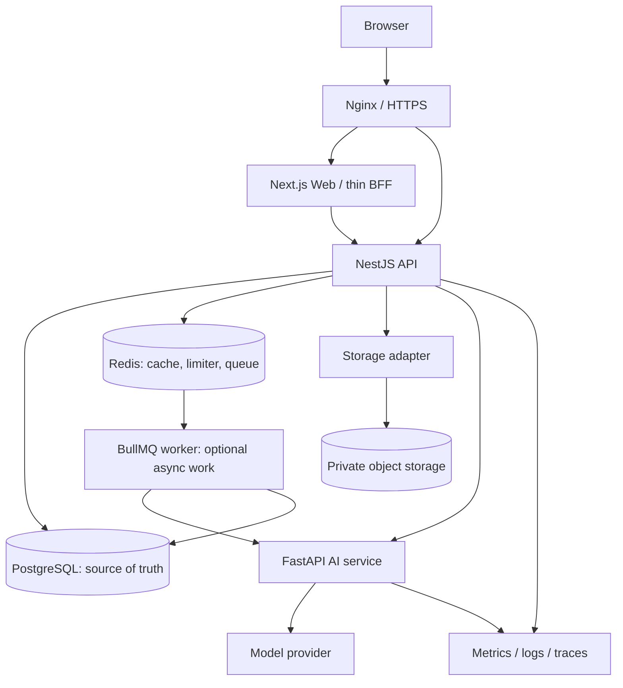

# ADR-004: Modular monolith as the target architecture

- Status: Proposed (decision and boundaries only; current code still has documented deviations below)
- Date: 2026-11-28
- Scope: Architecture decision for the LinguaAI learning platform. This ADR does not change code, schemas, tests or the roadmap checklist.
- Sources: `LinguaAI_Engineering_Roadmap.md` §2 (architecture target, lines 92–132) and §13.6 (ADR-004 deliverable, line 1183).

## Context

The roadmap §2 states the target directly: keep a NestJS modular monolith, Next.js UI and FastAPI AI service; do not add Kafka, Kubernetes, sharding or extra microservices merely to learn how to operate them. Queue, object storage and tracing are added only when a concrete, measured need appears. The platform still has unresolved billing, idempotency and permission risks (roadmap §1.2–1.3), so spreading the same uncertain logic across independently deployed services would multiply failure modes instead of reducing them.

Target runtime shape (roadmap §2, lines 96–113):

## Decision

Keep one NestJS API process composed of domain modules as the authoritative backend, one Next.js application with a thin BFF for UI-facing transport, and one FastAPI service dedicated to AI concerns. Do **not** introduce Kafka, Kubernetes, database sharding or extra microservices for educational purposes. Add a queue, object storage or distributed tracing only against the measurable triggers in “Reconsideration triggers” below.

### Ownership boundaries (verbatim from roadmap §2, lines 115–122)

| Layer | Sở hữu | Không nên sở hữu |
|---|---|---|
| Next.js | UI state, accessibility, rendering, session transport, thin BFF nếu cần | Quyết định giá token, gọi LLM bypass backend |
| NestJS | Auth, authorization, domain logic, billing, progress, orchestration, persisted request state | Prompt chuyên biệt rải rác khắp controller |
| FastAPI | Prompt, model client, schema validation, streaming provider, model routing, eval | Quyết định balance hoặc quyền sở hữu dữ liệu user |
| PostgreSQL | Ledger, request states, messages, attempts, learner state, durable jobs/outbox khi cần | Cache TTL |
| Redis | Cache, distributed rate limiter, queue transport | Số dư chính thức hoặc bằng chứng duy nhất đã grant credit |
| Object storage | Audio/image/blob private | Metadata quyền sở hữu (nằm DB) |

### NestJS module boundaries

`apps/api/src/app.module.ts` registers approximately 25 domain and infrastructure modules:

- Auth & Users: `AuthModule`, `UsersModule`.
- Decks, Cards, SRS, Learning: `DecksModule`, `CardsModule`, `SrsModule`, `LearningModule`.
- Quiz & Proficiency: `QuizModule`, `ProficiencyModule`.
- Content workflow: `ContentWorkflowModule`.
- AI-powered features: `WritingModule`, `ReadingModule`, `GrammarModule`, `ChatModule`, `AiOperationsModule`, `RecommendationsModule`.
- Admin, Analytics, Speaking: `AdminModule`, `AnalyticsModule`, `SpeakingModule`.
- System: `EmailModule`, `HealthModule`, `TokensModule`, `NotificationsModule`, `FilesModule`, plus `PrismaModule` and cross-cutting Nest configuration.

Rules:

1. A feature module consumes another feature only through an explicitly exported facade. Deep imports such as `@/other-feature/internal/service` are forbidden.
2. Facades that exist today: `TokensModule` is `@Global()` and exports `TokensService` (also `TokensReconciliationService`); `AiOperationsModule` imports `PrismaModule` and `TokensModule` and exports `AiOperationsService`; `ChatModule` imports `AiOperationsModule`; `SrsModule` imports `EmailModule`.
3. `ChatController` currently injects `AiOperationsService`, `AiOperationsPolicy`, `TokensService` and `PrismaService` directly. This is an orchestration seam to tighten in the BUG-02/BUG-03 follow-up: the controller should go through one exported chat/operations facade instead of accumulating cross-domain collaborators. This ADR records the seam; it does not implement it.
4. The NestJS API is the only authority for authentication, authorization, token pricing and debit, business persistence and orchestration. Prompt logic must not be scattered across controllers.

### FastAPI boundary

NestJS calls the AI service through `AI_SERVICE_URL` with the server-to-server `X-API-Key` header (see `apps/api/src/common/services/ai-client.service.ts`). FastAPI owns prompt templates, model routing, provider clients, schema validation, streaming and evaluation. It must not hold token balances, decide prices or own user data. The AI service key is a server-to-server credential, never a browser or BFF credential; no key value is recorded in this ADR.

### Persistence boundary

PostgreSQL is the single source of truth, including `user_token_balance`, `token_transactions`, `ai_operations`, `daily_credit_grants`, `chat_messages`, `srs_review_events` and `learning_completions`. Redis holds only caches, distributed rate-limit counters and optional queue transport; an official balance or credit-grant proof must never be derived from it. Object storage holds private audio/image/blob data; ownership metadata stays in PostgreSQL. Additional rules from roadmap §2.1: keep DB transactions short, never hold a lock while waiting for an LLM/network call, keep one operation ID per user intent across retries, treat multiple provider attempts as possible while business effects remain exactly-once in the DB, and keep prompt/audio/transcript/JWT/secret values out of default logs.

### Next.js boundary

Next.js owns UI state, accessibility, rendering and session transport, plus a thin BFF when needed. The BFF forwards to NestJS; it must not decide token prices, call an LLM provider directly, or debit credits itself.

### Permitted and forbidden dependencies

| From | Allowed | Forbidden |
|---|---|---|
| Web UI / BFF → NestJS | Authenticated API calls; BFF forwarding of session and request intent | Provider SDK/key, provider URL, direct DB access, direct debit or price calculation, bypassing NestJS to FastAPI |
| NestJS feature → NestJS feature | Imports of exported facades only (`TokensService`, `AiOperationsService`, `SrsService`, etc.) | Deep imports into another feature's internals, controllers importing unrelated domain repositories |
| NestJS → FastAPI | Server-to-server call with `AI_SERVICE_URL` and `X-API-Key`, via the shared AI client | Client-supplied price, provider credentials from browser, business persistence delegated to FastAPI |
| FastAPI → PostgreSQL / Redis | None for authoritative user state; diagnostics only if separately justified | Writing balances, operations, credit grants or ownership metadata |
| Any module → PostgreSQL | Short transactions; ledger and request states written via owning domain | Redis as authoritative balance/grant record |
| Any module → object storage | Private blobs via storage adapter; metadata written to DB | Ownership metadata kept only in blob storage |

## Consequences

Positive:

- Auth, billing and persistence stay in one deployable unit, where transactions and idempotency can be enforced without distributed coordination.
- Domain modules remain separable by exported facades, so a future extraction has an explicit seam instead of an import-graph rewrite.
- Prompt/model concerns stay in one AI service; business rules stay in NestJS; UI stays thin.
- Operational cost matches the current project stage: no Kafka/Kubernetes/sharding to learn for their own sake.

Negative:

- One monolith means shared deployment and blast radius; a bad change can affect several domains.
- Module boundaries rely on discipline and static checks; NestJS imports alone do not prevent deep imports.
- FastAPI is a separate deployment and network boundary: timeout, cancellation and partial-provider-failure handling remain necessary.
- Current code violates several of these boundaries (below); the decision is not yet fully reflected in implementation.

## Alternatives rejected

- **Microservices per domain (auth, billing, chat, SRS, content):** rejected because the roadmap forbids adding services merely to learn them, and because billing/idempotency risks need one transactional authority.
- **Kafka-backed event architecture:** rejected for the same reason; a queue is a later, measured addition. Redis/BullMQ transport is sufficient for optional async work.
- **Kubernetes and database sharding:** rejected as premature at the current scale and as unproven against measured need.
- **Single service with everything, including LLM calls, inside NestJS controllers:** rejected because prompt/routing/streaming/eval belong to FastAPI and scattered prompts are explicitly disallowed in roadmap §2.
- **Next.js server routes calling LLM providers or debiting tokens directly:** rejected because the BFF must be thin and NestJS is the only billing authority (BUG-03).

## Reconsideration triggers

Revisit this decision only when a need is measured and documented, not for novelty:

- A durable queue/outbox is introduced when lost or delayed asynchronous work is observed and a retry needs a durable record (durable jobs/outbox in PostgreSQL per roadmap §2).
- Object storage is introduced when private audio/image/blob volume or access patterns justify separation from DB/file-local handling.
- Distributed tracing is introduced when cross-service latency or failure attribution cannot be resolved from existing metrics and logs.
- Extracting a service is considered when a specific module shows an independently measured deployment, scaling or fault-isolation requirement that the monolith cannot meet, and its facade boundary is already enforced by tests.

## Current deviations (not yet compliant)

These are known implementation debts and must not be read as evidence that the boundary is already correct:

1. `apps/api/src/chat/chat.service.ts` still calls `GroqService.chatStream()` directly, bypassing the FastAPI boundary for that path.
2. `apps/api/src/chat/chat.controller.ts` injects `AiOperationsService`, `AiOperationsPolicy`, `TokensService` and `PrismaService` directly instead of a single exported orchestration facade.
3. Some Next.js BFF routes still touch billing/provider concerns. `apps/web/src/app/api/listening/upload-user/route.ts` reads `GROQ_API_KEY`/`GROQ_MODEL` and calls provider endpoints, and calls `/tokens/consume`; comments in `apps/web/src/app/api/speaking/topic/route.ts` and other speaking/listening/CMS generation routes show legacy `/tokens/consume` or provider-adjacent paths. These belong to the BUG-02/BUG-03 remediation slices.

Follow-up verification proposed for those slices (not added by this documentation-only ADR):

- `apps/api/test/architecture-boundaries.spec.ts`: static import scan forbidding deep imports between feature modules and provider SDK/key use in web BFF routes.
- `apps/api/test/ai-boundary.e2e-spec.ts`: every AI turn must reserve, create an `ai_operations` row and persist via NestJS; clients never submit a price.
- `apps/web/src/app/api/api-bff-boundaries.spec.ts`: BFF routes contain no provider key or direct provider URL.
- Existing regression suites to rerun when boundaries change: `chat-billing.e2e-spec.ts`, `chat-billing-orchestrator.spec.ts`, `tokens.e2e-spec.ts`, `srs-review.e2e-spec.ts` with `pnpm --dir apps/api test:e2e`, `pnpm type-check`, `pnpm test` and `python -m pytest apps/ai-service/tests -q`. No package manager was run in this documentation slice.

## Related decisions (forward references)

ADR-001 (centralized AI orchestration), ADR-002 (token ledger/reserve), ADR-003 (operation idempotency) and ADR-005 (mastery model) are planned deliverables from roadmap §13.6 and are referenced here as forward references; this ADR does not claim they exist or are accepted. Together with this ADR, they are intended to document the decisions enforced by the boundaries above.
