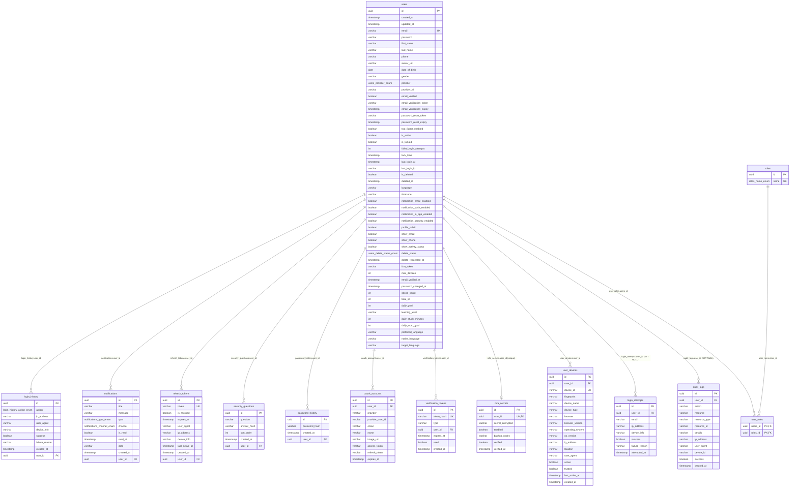

# Database Entity-Relationship Diagram

**Scope.** This ERD describes the deployed PostgreSQL schema of the LinguaAI API as of migration `20261129004000_daily_plans`. It is derived exclusively from:

- `apps/api/prisma/schema.prisma` — 45 Prisma models (physical table names equal model names).
- `apps/api/prisma/migrations/20261128003000_skill_proficiency/migration.sql` and `apps/api/prisma/migrations/20261128004000_content_workflow/migration.sql` — 3 tables that exist only in raw SQL (`skill_proficiency`, `placement_attempts`, `content_submissions`).

That is **48 real tables** and **10 native PostgreSQL enums**. No table appears in this document unless it is created by one of those inputs. Roadmap sketches, dropped legacy tables and hypothetical future tables are explicitly excluded (see [Exclusions](#exclusions)).

**Notation.** Mermaid `erDiagram` expresses entities, attributes and identifying/non-identifying relationships. It cannot express `ON DELETE` actions, partial unique keys, CHECK constraints or enum domains; those are documented in the [Constraint reference](#constraint-reference) and [Enum reference](#enum-reference) tables. Relationship labels read as `<parent> ||--o{ <child> : "<FK on child → parent>"`. `||` means exactly one parent, `o|` means zero-or-one, `o{` means zero-or-many. Labels are quoted because they contain underscores and parentheses.

The diagram is split into three clusters, all anchored on `users`, to keep each block legible in standard Mermaid renderers (GitHub, GitLab, VS Code, Mermaid Live Editor). `users` is repeated intentionally; it is one physical table.

---

## 1. Auth, security and notification cluster

`users` attributes above are the complete Prisma attribute set; in the next two clusters it is abbreviated to its key plus the relations used there.

---

## 2. Learning, content and gamification cluster

```mermaid
erDiagram
    users {
        uuid id PK
    }
    users ||--o{ decks : "decks.creator_id"
    users ||--o{ learning_completions : "learning_completions.user_id"
    users ||--o{ learning_attempts : "learning_attempts.user_id"
    users ||--o{ srs_review_events : "srs_review_events.user_id"
    users ||--o{ user_card_progress : "user_card_progress.user_id"
    users ||--o{ review_sessions : "review_sessions.user_id"
    users ||--o{ writing_submissions : "writing_submissions.user_id"
    users ||--o{ speaking_submissions : "speaking_submissions.user_id"
    users ||--o{ reading_passages : "reading_passages.generated_by_user_id"
    users ||--o{ chat_conversations : "chat_conversations.user_id"
    users ||--o{ quiz_attempts : "quiz_attempts.user_id"
    users ||--o{ quizzes : "quizzes.creator_id"
    users ||--o{ user_streaks : "user_streaks.user_id"
    users ||--o{ user_badges : "user_badges.user_id"

    decks ||--o{ cards : "cards.deck_id"
    decks ||--o{ review_sessions : "review_sessions.deck_id"
    decks ||--o| quizzes : "quizzes.deck_id (SET NULL)"
    cards ||--o{ srs_review_events : "srs_review_events.card_id"
    cards ||--o{ user_card_progress : "user_card_progress.card_id"
    chat_conversations ||--o{ chat_messages : "chat_messages.conversation_id"
    quizzes ||--o{ quiz_questions : "quiz_questions.quiz_id"
    quizzes ||--o{ quiz_attempts : "quiz_attempts.quiz_id"
    badges ||--o{ user_badges : "user_badges.badge_id"
    learning_completions ||--o{ learning_attempts : "learning_attempts.(user_id, activity_type, activity_id)"

    decks {
        uuid id PK
        varchar title
        varchar description
        varchar language
        varchar level
        boolean is_public
        uuid creator_id FK
        int card_count
        varchar learning_collection
        timestamp created_at
    }
    cards {
        uuid id PK
        uuid deck_id FK
        varchar front_text
        varchar back_text
        varchar ipa_pronunciation
        varchar audio_url
        varchar example_sentence
        varchar image_url
        varchar seed_key
        timestamp retired_at
        varchar learning_phrase_key
        timestamp created_at
    }
    learning_completions {
        uuid id PK
        uuid user_id FK
        varchar activity_type
        varchar activity_id
        varchar language
        int score
        int total
        int duration_seconds
        timestamp completed_at
        timestamp first_completed_at
        timestamp last_completed_at
        int attempt_count
        int best_score
        int latest_score
        int total_duration_seconds
    }
    learning_attempts {
        uuid id PK
        uuid user_id FK
        varchar language
        varchar activity_type
        varchar activity_id
        varchar content_version
        uuid client_attempt_id
        int raw_score
        int score_scale
        int normalized_score
        int total
        int duration_seconds
        timestamp started_at
        timestamp completed_at
        varchar feedback_ref
    }
    srs_review_events {
        uuid id PK
        uuid user_id FK
        uuid card_id FK
        json result
        timestamp created_at
    }
    user_card_progress {
        uuid id PK
        uuid user_id FK
        uuid card_id FK
        float ease_factor
        float difficulty
        int interval_days
        int repetition_count
        timestamp next_review_date
        timestamp last_review_date
        json quality_history
    }
    review_sessions {
        uuid id PK
        uuid user_id FK
        uuid deck_id FK
        int cards_reviewed
        int cards_correct
        int duration_seconds
        timestamp started_at
        timestamp finished_at
    }
    writing_submissions {
        uuid id PK
        uuid user_id FK
        varchar prompt_text
        varchar user_text
        json ai_feedback
        json score
        varchar language
        timestamp created_at
    }
    speaking_submissions {
        uuid id PK
        uuid user_id FK
        varchar topic
        varchar transcript
        varchar feedback
        json scores
        varchar language
        varchar level
        int duration_sec
        varchar audio_url
        timestamp created_at
    }
    reading_passages {
        uuid id PK
        uuid generated_by_user_id FK
        varchar passage_text
        json vocabulary
        json questions
        varchar level
        varchar topic
        varchar language
        timestamp created_at
    }
    chat_conversations {
        uuid id PK
        uuid user_id FK
        varchar title
        timestamp created_at
    }
    chat_messages {
        uuid id PK
        uuid conversation_id FK
        varchar role
        varchar content
        timestamp created_at
    }
    quizzes {
        uuid id PK
        varchar language
        varchar title
        varchar description
        uuid deck_id FK
        uuid creator_id FK
        int time_limit_minutes
        timestamp created_at
    }
    quiz_questions {
        uuid id PK
        uuid quiz_id FK
        varchar question_text
        varchar question_type
        json options
        varchar correct_answer
        varchar explanation
        int difficulty
    }
    quiz_attempts {
        uuid id PK
        uuid quiz_id FK
        uuid user_id FK
        int score
        int total_questions
        json answers
        int duration_seconds
        timestamp completed_at
    }
    user_streaks {
        uuid id PK
        uuid user_id FK
        varchar date
        int xp_earned
        int minutes_studied
    }
    badges {
        uuid id PK
        varchar name
        varchar description
        varchar icon_url
        json condition
    }
    user_badges {
        uuid user_id PK, FK
        uuid badge_id PK, FK
        timestamp earned_at
    }
    content_items {
        uuid id PK
        varchar type
        varchar title
        varchar title_vi
        varchar level
        varchar category
        varchar content
        json data
        json questions
        varchar audio_url
        varchar duration
        int word_count
        boolean published
        int sort_order
        timestamp created_at
        timestamp updated_at
    }
```

`content_items` has no foreign keys; it appears here because `content_submissions` (cluster 3) references it.

---

## 3. Token economy, adaptive learning and AI cluster

```mermaid
erDiagram
    users {
        uuid id PK
    }
    users ||--o| user_token_balance : "user_token_balance.user_id (PK/FK)"
    users ||--o{ token_transactions : "token_transactions.user_id"
    users ||--o{ ai_operations : "ai_operations.user_id"
    users ||--o{ daily_credit_grants : "daily_credit_grants.user_id"
    users ||--o{ skill_proficiency : "skill_proficiency.user_id (raw SQL)"
    users ||--o{ placement_attempts : "placement_attempts.user_id (raw SQL)"
    users ||--o{ daily_plans : "daily_plans.user_id"
    users ||--o{ learner_mastery : "learner_mastery.user_id"
    users ||--o{ mastery_events : "mastery_events.user_id"
    users ||--o{ learner_errors : "learner_errors.user_id"
    users ||--o{ content_submissions : "content_submissions.author_id (raw SQL)"
    users ||--o{ content_submissions : "content_submissions.reviewer_id (raw SQL, SET NULL)"

    content_items ||--o{ content_submissions : "content_submissions.content_item_id (raw SQL)"
    knowledge_items ||--o{ knowledge_prerequisites : "knowledge_prerequisites.knowledge_id"
    knowledge_items ||--o{ knowledge_prerequisites : "knowledge_prerequisites.prerequisite_id"
    knowledge_items ||--o{ activity_knowledge_items : "activity_knowledge_items.knowledge_id"
    knowledge_items ||--o{ learner_mastery : "learner_mastery.knowledge_id"
    knowledge_items ||--o{ mastery_events : "mastery_events.knowledge_id"
    knowledge_items ||--o| learner_errors : "learner_errors.knowledge_id (SET NULL)"
    daily_plans ||--o{ daily_plan_items : "daily_plan_items.daily_plan_id"

    user_token_balance {
        uuid user_id PK, FK
        int balance
    }
    token_transactions {
        uuid id PK
        uuid user_id FK
        int amount
        varchar type
        varchar feature
        int balance_after
        varchar idempotency_key UK
        timestamp created_at
    }
    ai_operations {
        uuid id PK
        uuid user_id FK
        varchar feature
        varchar client_operation_id
        varchar request_hash
        varchar pricing_version
        int reserved_credits
        int charged_credits
        ai_operations_status_enum status
        int attempt_count
        timestamp lease_until
        varchar lease_token
        int version
        uuid conversation_id
        uuid result_ref
        varchar error_code
        timestamp created_at
        timestamp updated_at
        timestamp finished_at
    }
    daily_credit_grants {
        uuid id PK
        uuid user_id FK
        daily_credit_grant_type grant_type
        date day
        int amount
        timestamp created_at
        timestamp updated_at
    }
    skill_proficiency {
        uuid user_id PK, FK
        varchar language PK
        varchar skill PK
        varchar cefr_estimate
        float confidence
        int evidence_count
        timestamp updated_at
    }
    placement_attempts {
        uuid id PK
        uuid user_id FK
        varchar language
        varchar skill
        float score
        int total
        varchar cefr_estimate
        timestamp created_at
    }
    content_submissions {
        uuid id PK
        uuid content_item_id FK
        uuid author_id FK
        varchar status
        uuid reviewer_id FK
        varchar review_notes
        int version
        timestamp created_at
        timestamp updated_at
    }
    knowledge_items {
        uuid id PK
        varchar language
        varchar skill
        varchar code
        varchar level
        varchar title
        varchar description
        varchar version
        timestamp created_at
        timestamp updated_at
    }
    knowledge_prerequisites {
        uuid knowledge_id PK, FK
        uuid prerequisite_id PK, FK
    }
    activity_knowledge_items {
        uuid id PK
        varchar activity_type
        varchar activity_id
        varchar content_version
        uuid knowledge_id FK
        float weight
    }
    daily_plans {
        uuid id PK
        uuid user_id FK
        date plan_date
        varchar timezone
        int version
        daily_plans_status status
        varchar goal
        timestamp created_at
        timestamp updated_at
    }
    daily_plan_items {
        uuid id PK
        uuid daily_plan_id FK
        int order_index
        varchar activity_type
        varchar activity_id
        varchar language
        varchar title
        int estimated_minutes
        varchar reason
        daily_plan_items_status status
        json knowledge_refs
        timestamp completed_at
        timestamp created_at
        timestamp updated_at
    }
    learner_mastery {
        uuid user_id PK, FK
        uuid knowledge_id PK, FK
        float success_weight
        float failure_weight
        int evidence_count
        timestamp last_practiced_at
        timestamp updated_at
    }
    mastery_events {
        uuid id PK
        uuid user_id FK
        varchar attempt_id
        uuid knowledge_id FK
        varchar evidence_type
        float score
        float weight
        timestamp created_at
    }
    learner_errors {
        uuid id PK
        uuid user_id FK
        varchar attempt_id
        uuid knowledge_id FK
        varchar error_type
        varchar excerpt
        varchar correction
        float confidence
        varchar status
        timestamp created_at
    }
```

`knowledge_prerequisites` has two distinct foreign keys to `knowledge_items`; the Mermaid block shows both as duplicate relationships because Mermaid has no role-name syntax on relationship lines. The two columns are `knowledge_id` (the item that has the prerequisite) and `prerequisite_id` (the prerequisite item). Both are `ON DELETE CASCADE`.

---

## Enum reference

All 10 enums are native PostgreSQL enums defined in `schema.prisma`. Mermaid `erDiagram` cannot render enum domains, so enum-typed attributes in the blocks above use the enum name as their type.

| Enum | Values | Used by |
|---|---|---|
| `login_history_action_enum` | `LOGIN_SUCCESS`, `LOGIN_FAILED`, `LOGOUT`, `LOGOUT_ALL`, `LOGOUT_SESSION`, `MFA_ENABLED`, `MFA_DISABLED`, `PASSWORD_CHANGED`, `ACCOUNT_LOCKED`, `ACCOUNT_DELETED` | `login_history.action` |
| `notifications_channel_enum` | `EMAIL`, `PUSH`, `IN_APP`, `WEB_PUSH` | `notifications.channel` |
| `notifications_type_enum` | `SYSTEM`, `SECURITY`, `ACCOUNT` | `notifications.type` |
| `roles_name_enum` | `ADMIN`, `USER`, `MODERATOR` | `roles.name` |
| `users_delete_status_enum` | `ACTIVE`, `DELETE_REQUESTED`, `GRACE_PERIOD`, `PERMANENTLY_DELETED` | `users.delete_status` |
| `users_provider_enum` | `LOCAL`, `GOOGLE`, `GITHUB` | `users.provider` |
| `ai_operations_status_enum` | `RESERVED`, `RUNNING`, `SUCCEEDED`, `FAILED`, `UNKNOWN`, `CANCELLED` | `ai_operations.status` |
| `daily_credit_grant_type` | `DAILY_TOPUP`, `DAILY_CHECKIN` | `daily_credit_grants.grant_type` |
| `daily_plans_status` | `ACTIVE`, `ARCHIVED` | `daily_plans.status` |
| `daily_plan_items_status` | `PENDING`, `IN_PROGRESS`, `COMPLETED`, `SKIPPED` | `daily_plan_items.status` |

Raw-SQL-only tables deliberately use plain `VARCHAR` instead of enums: `content_submissions.status` accepts the application-owned vocabulary `PENDING` (default), `APPROVED`, `REJECTED`; `skill_proficiency.cefr_estimate` and `placement_attempts.cefr_estimate` hold free-form CEFR estimates. No CHECK constraints were added for these columns.

---

## Constraint reference

### Keys and uniqueness

| Table | Primary key | Additional unique constraints |
|---|---|---|
| `users` | `id` | `email` |
| `login_history` | `id` | — |
| `notifications` | `id` | — |
| `refresh_tokens` | `id` | `token` |
| `roles` | `id` | `name` |
| `security_questions` | `id` | — |
| `user_roles` | (`users_id`, `roles_id`) | — |
| `password_history` | `id` | — |
| `oauth_accounts` | `id` | (`provider`, `provider_user_id`) |
| `verification_tokens` | `id` | `token_hash` |
| `mfa_secrets` | `id` | `user_id` → 1:1 with `users` |
| `user_devices` | `id` | `device_id` |
| `login_attempts` | `id` | — |
| `audit_logs` | `id` | — |
| `decks` | `id` | (`creator_id`, `learning_collection`) |
| `cards` | `id` | (`deck_id`, `seed_key`), (`deck_id`, `learning_phrase_key`) |
| `learning_completions` | `id` | (`user_id`, `activity_type`, `activity_id`) |
| `learning_attempts` | `id` | (`user_id`, `client_attempt_id`) |
| `srs_review_events` | `id` | — |
| `user_card_progress` | `id` | (`user_id`, `card_id`) |
| `review_sessions` | `id` | — |
| `writing_submissions` | `id` | — |
| `speaking_submissions` | `id` | — |
| `reading_passages` | `id` | — |
| `chat_conversations` | `id` | — |
| `chat_messages` | `id` | — |
| `quizzes` | `id` | — |
| `quiz_questions` | `id` | — |
| `quiz_attempts` | `id` | — |
| `user_streaks` | `id` | (`user_id`, `date`) |
| `badges` | `id` | — |
| `user_badges` | (`user_id`, `badge_id`) | — |
| `content_items` | `id` | — |
| `user_token_balance` | `user_id` → 1:1 with `users` | — |
| `token_transactions` | `id` | `idempotency_key` |
| `ai_operations` | `id` | (`user_id`, `feature`, `client_operation_id`) |
| `daily_credit_grants` | `id` | (`user_id`, `grant_type`, `day`) |
| `knowledge_items` | `id` | (`language`, `code`, `version`) |
| `knowledge_prerequisites` | (`knowledge_id`, `prerequisite_id`) | — |
| `activity_knowledge_items` | `id` | (`activity_type`, `activity_id`, `content_version`, `knowledge_id`) |
| `daily_plans` | `id` | (`user_id`, `plan_date`, `version`) |
| `daily_plan_items` | `id` | (`daily_plan_id`, `order_index`) |
| `learner_mastery` | (`user_id`, `knowledge_id`) | — |
| `mastery_events` | `id` | (`attempt_id`, `knowledge_id`, `evidence_type`) |
| `learner_errors` | `id` | — |
| `skill_proficiency` (raw SQL) | (`user_id`, `language`, `skill`) | — |
| `placement_attempts` (raw SQL) | `id` | — |
| `content_submissions` (raw SQL) | `id` | none (resubmissions create new version rows) |

All UUID primary keys except `user_roles`, `user_badges`, `knowledge_prerequisites`, `learner_mastery`, `user_token_balance` and raw-SQL `skill_proficiency` are generated by `uuid_generate_v4()` (the `uuid-ossp` extension is installed by the baseline migration). `srs_review_events.id` is a client-supplied UUID with no default.

### Foreign keys and delete behavior

| Child table → parent table | FK column(s) | `ON DELETE` | `ON UPDATE` |
|---|---|---|---|
| `login_history` → `users` | `user_id` (nullable) | `CASCADE` | `NO ACTION` |
| `notifications` → `users` | `user_id` (nullable) | `CASCADE` | `NO ACTION` |
| `refresh_tokens` → `users` | `user_id` (nullable) | `CASCADE` | `NO ACTION` |
| `security_questions` → `users` | `user_id` (nullable) | `CASCADE` | `NO ACTION` |
| `password_history` → `users` | `user_id` (nullable) | `CASCADE` | `NO ACTION` |
| `user_roles` → `users` | `users_id` | `CASCADE` | default |
| `user_roles` → `roles` | `roles_id` | `CASCADE` | default |
| `oauth_accounts` → `users` | `user_id` | `CASCADE` | default |
| `verification_tokens` → `users` | `user_id` | `CASCADE` | default |
| `mfa_secrets` → `users` | `user_id` (unique) | `CASCADE` | default |
| `user_devices` → `users` | `user_id` | `CASCADE` | default |
| `login_attempts` → `users` | `user_id` (nullable) | `SET NULL` | default |
| `audit_logs` → `users` | `user_id` (nullable) | `SET NULL` | default |
| `decks` → `users` | `creator_id` | `CASCADE` | default |
| `cards` → `decks` | `deck_id` | `CASCADE` | default |
| `learning_completions` → `users` | `user_id` | `CASCADE` | default |
| `learning_attempts` → `users` | `user_id` | `CASCADE` | default |
| `learning_attempts` → `learning_completions` | (`user_id`, `activity_type`, `activity_id`) | `CASCADE` | `CASCADE` |
| `srs_review_events` → `users` | `user_id` | `CASCADE` | default |
| `srs_review_events` → `cards` | `card_id` | `CASCADE` | default |
| `user_card_progress` → `users` | `user_id` | `CASCADE` | default |
| `user_card_progress` → `cards` | `card_id` | `CASCADE` | default |
| `review_sessions` → `users` | `user_id` | `CASCADE` | default |
| `review_sessions` → `decks` | `deck_id` | `CASCADE` | default |
| `writing_submissions` → `users` | `user_id` | `CASCADE` | default |
| `speaking_submissions` → `users` | `user_id` | `CASCADE` | default |
| `reading_passages` → `users` | `generated_by_user_id` | `CASCADE` | default |
| `chat_conversations` → `users` | `user_id` | `CASCADE` | default |
| `chat_messages` → `chat_conversations` | `conversation_id` | `CASCADE` | default |
| `quizzes` → `users` | `creator_id` | `CASCADE` | default |
| `quizzes` → `decks` | `deck_id` (nullable) | `SET NULL` | default |
| `quiz_questions` → `quizzes` | `quiz_id` | `CASCADE` | default |
| `quiz_attempts` → `users` | `user_id` | `CASCADE` | default |
| `quiz_attempts` → `quizzes` | `quiz_id` | `CASCADE` | default |
| `user_streaks` → `users` | `user_id` | `CASCADE` | default |
| `user_badges` → `users` | `user_id` | `CASCADE` | default |
| `user_badges` → `badges` | `badge_id` | `CASCADE` | default |
| `user_token_balance` → `users` | `user_id` (PK) | `CASCADE` | default |
| `token_transactions` → `users` | `user_id` | `CASCADE` | default |
| `ai_operations` → `users` | `user_id` | `CASCADE` | default |
| `daily_credit_grants` → `users` | `user_id` | `CASCADE` | default |
| `knowledge_prerequisites` → `knowledge_items` | `knowledge_id` | `CASCADE` | default |
| `knowledge_prerequisites` → `knowledge_items` | `prerequisite_id` | `CASCADE` | default |
| `activity_knowledge_items` → `knowledge_items` | `knowledge_id` | `CASCADE` | default |
| `daily_plans` → `users` | `user_id` | `CASCADE` | default |
| `daily_plan_items` → `daily_plans` | `daily_plan_id` | `CASCADE` | default |
| `learner_mastery` → `users` | `user_id` | `CASCADE` | `NO ACTION` |
| `learner_mastery` → `knowledge_items` | `knowledge_id` | `CASCADE` | `NO ACTION` |
| `mastery_events` → `users` | `user_id` | `CASCADE` | `NO ACTION` |
| `mastery_events` → `knowledge_items` | `knowledge_id` | `CASCADE` | `NO ACTION` |
| `learner_errors` → `users` | `user_id` | `CASCADE` | `NO ACTION` |
| `learner_errors` → `knowledge_items` | `knowledge_id` (nullable) | `SET NULL` | `NO ACTION` |
| `skill_proficiency` → `users` (raw SQL) | `user_id` | `CASCADE` | `CASCADE` |
| `placement_attempts` → `users` (raw SQL) | `user_id` | `CASCADE` | `CASCADE` |
| `content_submissions` → `content_items` (raw SQL) | `content_item_id` | `CASCADE` | `NO ACTION` |
| `content_submissions` → `users` (raw SQL) | `author_id` | `CASCADE` | `NO ACTION` |
| `content_submissions` → `users` (raw SQL) | `reviewer_id` (nullable) | `SET NULL` | `NO ACTION` |

That is 57 foreign-key constraints: 52 declared by Prisma relations (counting the composite FK once) plus 5 declared in raw-SQL migrations. The three Mermaid blocks contain 48 distinct entities (`users` is repeated across blocks).

Special cases worth noting when reading the diagram:

- `mfa_secrets` and `user_token_balance` are true 1:1 tables: their `user_id` is both a unique/primary key and an FK.
- `login_attempts`, `audit_logs`, `quizzes.deck_id` and `learner_errors.knowledge_id` use `SET NULL`; columns are nullable by design to preserve logs after a parent is deleted.
- `ai_operations.conversation_id` and `ai_operations.result_ref` are plain `UUID` columns with **no FK** — the ledger intentionally does not couple to chat or session ownership rules. They are shown as attributes, not relationships.
- `mastery_events.attempt_id`, `learner_errors.attempt_id` and `learning_attempts.activity_id` are `VARCHAR`, not UUID FKs: they can carry external/legacy identifiers.
- `learning_attempts` has a composite FK to `learning_completions` on (`user_id`, `activity_type`, `activity_id`), with `ON DELETE CASCADE ON UPDATE CASCADE`.
- `knowledge_prerequisites` is a self-relationship of `knowledge_items` with two roles; the pair is its composite PK.

---

## Exclusions

The following names are deliberately **not** entities in this ERD:

- **Roadmap-only sketches that were never created in the database.** `LinguaAI_Engineering_Roadmap.md` §12 (around lines 995–1020) proposed `learning_attempts`, `knowledge_items`, `knowledge_prerequisites`, `activity_knowledge_items`, `learner_mastery`, `mastery_events` and `learner_errors`. Those proposals are now implemented and therefore **are** in the diagram above, sourced from `schema.prisma` and migrations — not from the roadmap. Any other table mentioned only in prose without a `CREATE TABLE` in migrations or a `model` in `schema.prisma` is excluded.
- **`device_fingerprints`** — present in `20250101000000_baseline_init`, merged into `user_devices` and dropped by `20250106000000_merge_device_fingerprints_to_user_devices`. Its successor `user_devices.fingerprint` is included.
- **Views, materialized views, sequences and extensions** — not modeled by Mermaid `erDiagram` and not entity tables.
- **Redis keys, in-memory caches and request DTOs** — not PostgreSQL relations.

If a new table is added in a future migration, update this document in the same change: add the entity to the appropriate cluster, add its keys and FKs to the constraint reference, and update the table counts above.
