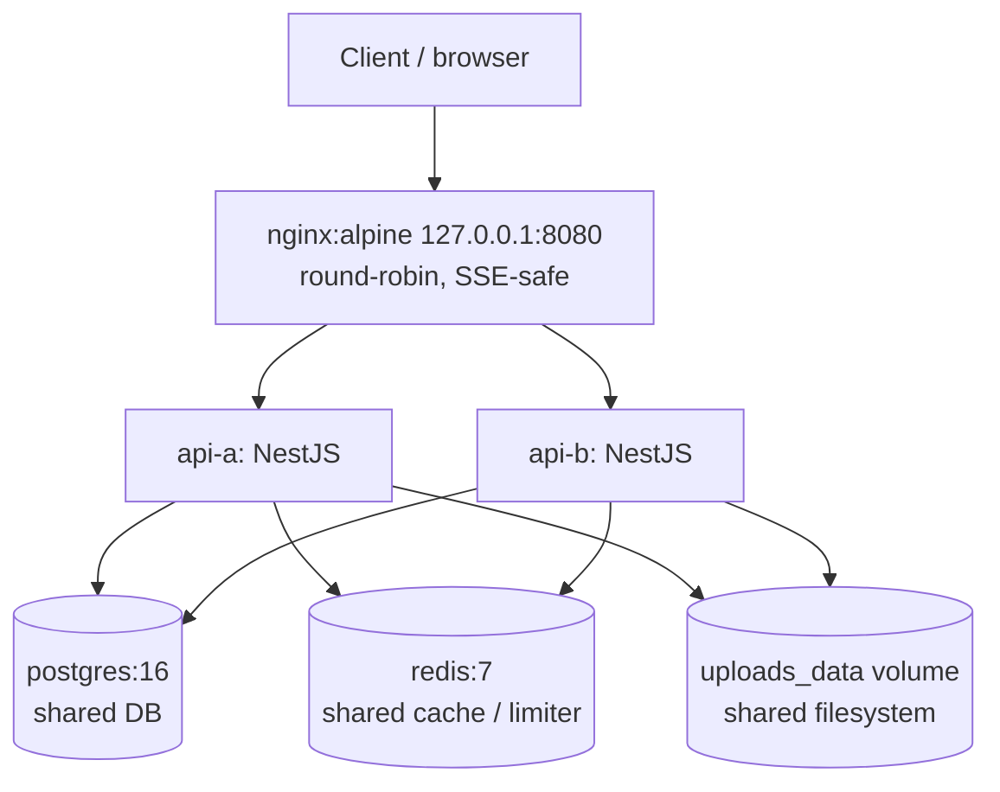

# Horizontal Scaling Lab Design (OPS-17 / PERF-02)

**Status:** Design document — implementation plan only, no files changed yet
**Scope:** Multi-instance SSE, status replay, and upload test design
**Infrastructure:** Docker Compose two-replica lab (no Kubernetes)
**Anchor:** `LinguaAI_Engineering_Roadmap.md` lines 957-964 (PERF-02)
**Code audit date:** 2026-11-28 (contracts below reflect the current working tree)

## 1. Objective

Validate that the platform behaves correctly when multiple API instances share one PostgreSQL database and one Redis instance. Specifically:

- SSE connections can reconnect to a different instance and recover terminal state.
- Idempotency keys prevent duplicate provider calls across instances.
- Token reserve/settle/refund remain atomic under concurrent claims.
- Files written by instance A are visible to instance B.
- No authoritative state (sessions, quotas, in-flight operations) lives in process memory.

This is a **test design document**, not a claim that the tests have been run. The lab proves invariants; it does not measure throughput or define SLOs (those belong in `docs/benchmarks/` after the lab runs).

## 2. Topology



### Key decisions

1. **No fixed container names or host ports for API replicas.** Both `api-a` and `api-b` are separate Compose services derived from the base `api` service; neither publishes a fixed host port. The proxy reaches them over the Compose network by service name.
2. **Single migration job.** The `migrate` service runs once before either API starts; neither replica runs `prisma migrate deploy` at boot.
3. **Shared uploads volume today, object storage later.** The currently wired storage is `StorageAdapter` in `apps/api/src/files/file-validation.ts`, which writes under `<cwd>/uploads` and serves files from public static `/uploads/`. Both replicas must mount the same `uploads_data` volume at `/app/apps/api/uploads`, and `API_URL` must point at the proxy so absolute URLs stay reachable. REL-04 remains the slice that introduces a real `StoragePort` implementation and signed reads.
4. **No Kubernetes.** Docker Compose is sufficient for beta; the lab validates invariants, not orchestration. `docs/sprint6-report.md` currently records the PERF-02 lab as NOT RUN.

## 3. Current contracts (verified in code)

### 3.1 Chat SSE and Idempotency

**Route:** `POST /api/v1/chat/stream`
**Header:** `Idempotency-Key: <uuid-v4-like or opaque key>`
**SSE events:** `accepted`, `delta`, `failed`, `completed`

**Terminal state contract** (`apps/api/src/chat/chat.controller.ts`, lines 258-424):

- `accepted` carries `operationId` and `conversationId`.
- `completed` is emitted only after persistence commits and `finalizeSuccess` settles the operation; it carries `messageId` and `balance`.
- EOF without `completed` is never success: the operation is failed with `PROVIDER_TIMEOUT`, which maps to `UNKNOWN` in the operation policy, and a `failed` event is emitted.
- Replaying a `SUCCEEDED` operation with the same key emits the saved content once and returns without calling the provider or debiting again.
- Pre-flight failures (bad key, quota, ownership) are ordinary HTTP errors; the SSE contract applies only after headers are flushed.

**Cross-instance reconnect:**

1. Client connects to instance A, receives `accepted` with `operationId`, then the connection drops.
2. Client reconnects (through the proxy or directly to B) and calls `GET /api/v1/chat/operations/<operationId>`.
3. Instance B reads committed DB state only: it returns `{ data: { operationId, status, result: { messageId, role, content } | null } }`. It never starts a provider call, charges credits, or mutates the operation.
4. Ownership is enforced: unknown id → 404, another user's id → 403. No answer or email is leaked.
5. The frontend already probes both `/ai-operations/<id>` and `/chat/operations/<id>` (`apps/web/src/app/(dashboard)/chat/page.tsx:137`); both must work regardless of which instance served the original SSE.

### 3.2 Token reserve / settle / refund

`apps/api/src/tokens/tokens.service.ts` uses `Serializable` transactions for debits, grants and settlement. `ai_operations` (schema lines 684-718) stores one row per `(user_id, feature, client_operation_id)` with a `version`, lease token, `attempt_count`, `reserved_credits` and `charged_credits`. `token_transactions.idempotency_key` is unique; refund keys are deterministic (`refund:aiop:<operationId>`).

Expected invariants: balance never negative, at most one debit per operation, at most one refund per operation, and `FakeLlmProvider.callCount === 1` per idempotency key no matter how many instances receive the request.

### 3.3 Files (current state, not final storage design)

Only `POST /api/v1/files/upload` exists on `FilesController`; there is no `GET`/`HEAD`/`DELETE /files/:key` route yet. The wired `StorageAdapter` generates owner-scoped keys (`<userId>/<uuid>.<ext>`), writes them under `<cwd>/uploads`, and returns a public URL built from `API_URL`. `LocalStorageAdapter` in `apps/api/src/files/storage.adapter.ts` already demonstrates a `StoragePort` with `signedReadUrl`, but it is **not** wired into `FilesModule` and `/api/v1/files/signed` is **not** mounted. Therefore the A/B file checks in section 4 exercise the shared volume through service-layer calls (`put`/`head`/`delete`/`assertOwner`) rather than a signed-URL HTTP route. Adding signed reads is REL-04 scope, not this slice.

Signed URLs, once mounted, require the same `STORAGE_SIGNING_SECRET` on both replicas; the signature covers key and absolute expiry and is verified with `timingSafeEqual`.

## 4. Test matrix

The proposed E2E suite (`apps/api/test/horizontal-scaling.e2e-spec.ts`) boots two NestJS app contexts sharing one PostgreSQL test DB and one Redis fake. Each test asserts the invariant listed below.

| # | Scenario | Instance A | Instance B | Assertion |
|---|----------|------------|------------|-----------|
| T01 | SSE on A, status on B | `POST /chat/stream` with key K; receive `accepted`; drop connection before terminal event | `GET /chat/operations/<operationId>` | Status is terminal (`SUCCEEDED` or `FAILED`/`UNKNOWN`), result matches the committed message when succeeded; one debit; `callCount === 1` |
| T02 | Same-key concurrent claim | `POST /chat/stream` with key K | `POST /chat/stream` with key K, same user/payload | Same `operationId` returned; exactly one provider call and one debit |
| T03 | Instance A dies mid-stream | `POST /chat/stream`; terminate A after first `delta`, before commit | `GET /chat/operations/<operationId>` | No `completed` without a committed message; `UNKNOWN`/`FAILED` state is recoverable; no duplicate debit |
| T04 | Reserve on A, settle on B | `reserveTokens(user, op, 10)` | `settleTokens(op)` | Balance drops once; one debit + one settle ledger row; no refund |
| T05 | Refund split across instances | `reserveTokens` on A; operation fails | `refundTokens` on B | Balance returns to start; one debit + one refund, key `refund:aiop:<opId>`; replaying refund is a no-op |
| T06 | Upload on A, head on B | `storage.put(key, buffer)` + DB row `READY` via A's `FilesService` | `storage.head(key)` and `assertOwner(key, user)` via B | Same shared volume returns size; DB row still `READY`; absolute URL uses proxy `API_URL` |
| T07 | Upload on A, delete on B | Upload via A | `storage.delete(key)` + mark `DELETING` via B | File gone from shared volume; owner check rejects another user |
| T08 | SRS review on A, stats on B | `POST /srs/review` with card IDs | `GET /srs/stats` | `user_card_progress` and `srs_review_events` reflect exactly one review; no duplicate event |
| T09 | Shared rate limiter (expected FAIL today) | Exhaust the limit with requests to A | Send one request to B | **Known gap:** `ThrottlerModule.forRoot` in `app.module.ts` has no storage backend, so counters are per-process; B still returns 200. Record as FAIL and file a separate SEC-06 slice, do not patch here |
| T10 | Signed URL across replicas (blocked) | `signedReadUrl(key)` via the future port | `GET /api/v1/files/signed` on B | Blocked: route and DI wiring do not exist yet; list as NOT IMPLEMENTED, not PASS |

### Fixture reuse

The suite reuses `FIXTURE`, `seedChatBillingFixtures`, `FakeLlmProvider`, `FakeRedis`, and `parseSseEvents` from `apps/api/test/fixtures/chat-billing.fixture.ts`. A new `horizontal-scaling.fixture.ts` exposes `bootInstance(name)`, `httpPort(instance)`, `stopInstance(instance)`, `createOperationKey()`, `assertLedgerInvariant(userId)`, and `assertSingleProviderAttempt(key)`. Both instances share the same fake provider/Redis objects and the same `PrismaClient` pointed at the disposable test DB.

An in-memory `StoragePort` fixture with a shared backing `Map` keyed by server-generated object key is proposed for T06/T07 so the A/B suite needs no real credentials or filesystem state; fault injection (`put` throws, `head` returns null) covers failed finalize. The Compose lab separately proves the real shared-volume mount with a manual smoke check.

### Invariant assertions

`assertLedgerInvariant(userId)` checks: running balance never negative; at most one `consumption` row per operation idempotency key; at most one `refund` row per operation.
`assertSingleProviderAttempt(key)` checks `FakeLlmProvider.callCount === 1` for the key under test.

## 5. Compose override (proposed, not yet created)

**File:** `docker/docker-compose.scaling.yml`

```yaml
services:
  # Base compose defines one `api` with fixed container_name and a host port.
  # The lab uses two derived services and an SSE-safe proxy instead.
  api-a:
    extends:
      file: docker-compose.yml
      service: api
    container_name: linguaai-api-a
    ports: []            # no host publish; reachable via the proxy and Compose DNS
    environment:
      INSTANCE_NAME: api-a

  api-b:
    extends:
      file: docker-compose.yml
      service: api
    container_name: linguaai-api-b
    ports: []            # no host publish
    environment:
      INSTANCE_NAME: api-b

  proxy:
    image: nginx:alpine
    container_name: linguaai-proxy
    restart: unless-stopped
    ports:
      - "127.0.0.1:8080:80"
    volumes:
      - ./nginx.scaling.conf:/etc/nginx/nginx.conf:ro
    depends_on:
      api-a:
        condition: service_healthy
      api-b:
        condition: service_healthy
    networks:
      - linguaai-net

volumes:
  postgres_data:
  redis_data:
  uploads_data:
```

Note: Compose `extends` does not merge the base `api` service's container name away; the override must explicitly clear `container_name` and `ports` as shown. Validate with `docker compose config --quiet` and capture only the exit code — never paste interpolated config, which contains secrets.

**Proxy config** (`docker/nginx.scaling.conf`):

```nginx
events { worker_connections 1024; }

http {
  upstream api_backend {
    server api-a:3001;
    server api-b:3001;
  }
  server {
    listen 80;
    location / {
      proxy_pass http://api_backend;
      proxy_http_version 1.1;
      proxy_set_header Host $host;
      proxy_set_header X-Real-IP $remote_addr;
      proxy_set_header X-Forwarded-For $proxy_add_x_forwarded_for;
      proxy_set_header Connection '';   # hop-by-hop, required for SSE
      proxy_buffering off;
      proxy_cache off;
      proxy_read_timeout 300s;
      chunked_transfer_encoding off;
    }
  }
}
```

Run:

```bash
COMPOSE_PROJECT_NAME=scaling-lab \
  docker compose -f docker/docker-compose.yml -f docker/docker-compose.scaling.yml up -d
```

## 6. Execution plan

### 6.1 Pre-flight

1. Create a disposable test DB (default in existing E2E fixtures is `linguaai_test` at `DATABASE_URL`).
2. Run `pnpm prisma migrate deploy` in `apps/api` against that DB. Never run migrations from a replica at boot.
3. Confirm no real credentials are needed: the E2E suite overrides `GroqService` and `RedisService` with fakes; never read or print `.env` values.

### 6.2 Run the E2E suite

```bash
pnpm --filter api test:e2e -- horizontal-scaling
```

Record per-test PASS/FAIL. T09 is expected FAIL and T10 is NOT IMPLEMENTED under current code; both are reported as gaps, not silently removed.

### 6.3 Manual Compose smoke

```bash
COMPOSE_PROJECT_NAME=scaling-lab \
  docker compose -f docker/docker-compose.yml -f docker/docker-compose.scaling.yml up -d

# Health through the proxy (status code only)
curl -sS -o /dev/null -w '%{http_code}\n' http://127.0.0.1:8080/api/health

# SSE through the proxy (use fixture credentials/tokens only)
curl -N http://127.0.0.1:8080/api/v1/chat/stream \
  -H "Authorization: Bearer <fixture-token>" \
  -H "Idempotency-Key: scaling-lab-1" \
  -H "Content-Type: application/json" \
  -d '{"message":"hello","language":"english","conversationId":"<fixture-uuid>"}'

# Status replay: the operationId from `accepted` is readable through either replica
curl -sS http://127.0.0.1:8080/api/v1/chat/operations/<operationId> \
  -H "Authorization: Bearer <fixture-token>"
```

Kill A mid-stream with `docker compose ... stop api-a`, then repeat the status call; the proxy routes to B. Confirm the shared-upload mount with `docker compose ... exec -T api-b sh -c 'ls /app/apps/api/uploads'` after an upload through A.

## 7. Measured vs. unverified

**To be measured by this lab:** cross-instance SSE replay and idempotency, token invariants under split-instance claims, shared-file visibility, SRS state consistency.

**Known gaps before the lab runs:** in-memory throttler counters (T09); no mounted signed-read route (T10).

**Explicitly out of scope:** throughput/p95/SLO (see `docs/benchmarks/`), Kubernetes manifests, cross-instance WebSocket broadcast (the app uses `@nestjs/platform-ws`, not Socket.IO — do not add a Socket.IO Redis adapter and assume it works), and DB pool sizing under load (`docs/benchmarks/connection-budget.md`).

## 8. Rollback and cleanup

```bash
COMPOSE_PROJECT_NAME=scaling-lab \
  docker compose -f docker/docker-compose.yml -f docker/docker-compose.scaling.yml down -v
```

Use a unique `COMPOSE_PROJECT_NAME`; `down -v` against a shared or production stack is forbidden. Reset the disposable test DB by dropping and recreating it, then re-running migrations. No production data is touched.

## 9. Blockers and follow-ups (out-of-scope changes)

1. **Shared rate limiter (T09).** `ThrottlerModule.forRoot` in `apps/api/src/app.module.ts` has no storage backend, so counters are per-process. A Redis-backed store is SEC-06 scope with its own tests; this slice records the FAIL only.
2. **Signed reads (T10).** `LocalStorageAdapter` exists but is not wired into `FilesModule`; `/api/v1/files/signed` is not mounted. REL-04 scope.
3. **Upload volume.** If the two replicas do not mount the same `uploads_data` path, A/B file checks fail. Verify the mount before blaming the app; the minimal fix is the shared volume, not an app-code change.
4. **WebSocket broadcast.** Raw `WsAdapter` from `@nestjs/platform-ws` provides no cross-instance fan-out. Separate design slice if needed.
5. **Docs link.** After the lab is actually run, append a link and measured results to `docs/baseline.md`; do not invent values now.

## 10. References

- `LinguaAI_Engineering_Roadmap.md` lines 957-964 (PERF-02), lines 544-556 (REL-04)
- `apps/api/src/chat/chat.controller.ts` lines 258-424 (SSE stream), lines 680-730 (status endpoint)
- `apps/api/src/ai-operations/ai-operations.service.ts`, `apps/api/src/tokens/tokens.service.ts`
- `apps/api/prisma/schema.prisma` lines 666-718 (ledger and operation tables)
- `apps/api/src/files/file-validation.ts` (wired `StorageAdapter`), `apps/api/src/files/storage.adapter.ts` (future `StoragePort`)
- `apps/api/test/fixtures/chat-billing.fixture.ts` (fake provider/Redis and SSE parser)
- `docs/infra-smoke.md`, `docs/sprint6-report.md` (current NOT RUN status), `docs/benchmarks/`
